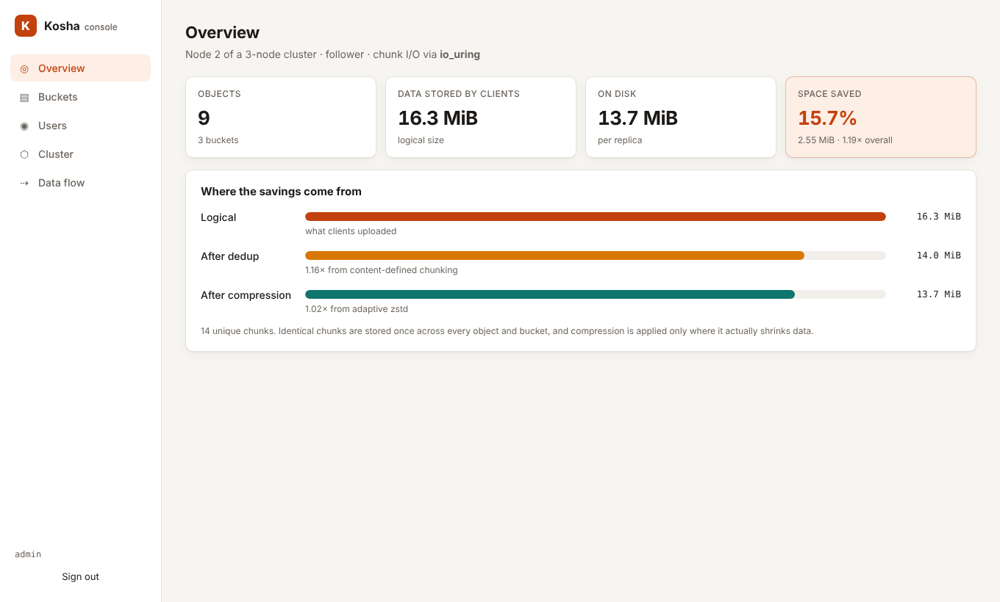
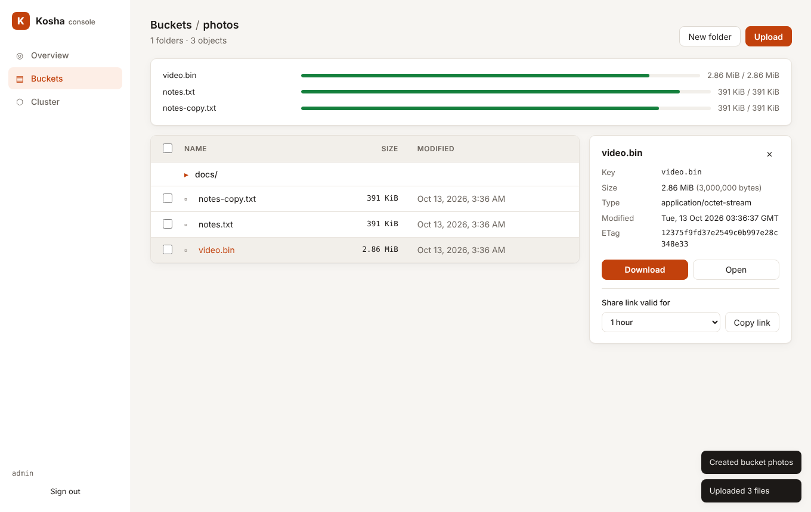
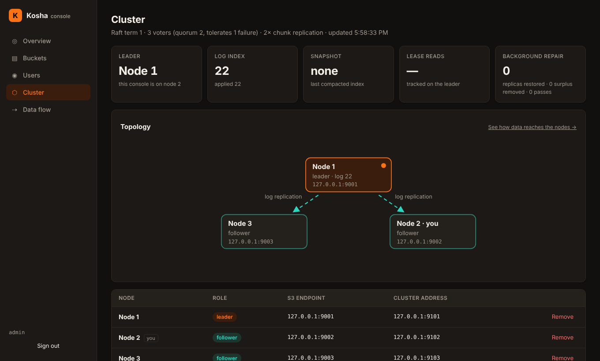

# Kosha

**Kosha** (कोश, "treasury") is an S3-compatible object store written in Rust.

It speaks the S3 API, so existing tools and SDKs work unchanged. Underneath, it is
not a clone of S3's design. Kosha stores data the way modern backup and
content-addressed systems do, replicates it with Raft, and drives the disk
with io_uring.



| | Classic object store | Kosha |
|---|---|---|
| Unit of storage | whole object / fixed blocks | **content-defined chunks** (FastCDC) |
| Identity | key → file | key → manifest of **BLAKE3**-addressed chunks |
| Duplicate data | stored again | **stored once, globally** (across objects, buckets, multipart parts) |
| Server-side copy | re-reads and re-writes bytes | **metadata only** (a 256 MiB copy takes ~3 ms) |
| Multipart complete | concatenates part files | **concatenates manifests**, no data moved |
| Compression | none or always | **adaptive** zstd: probes each chunk, skips incompressible data |
| Integrity | optional checksums | **every chunk verified on every read**, including reads from other nodes |
| Disk I/O | blocking syscalls on a thread pool | **io_uring** (falls back to threads where it's unavailable) |
| Metadata | files / ad-hoc database | **Raft-replicated ACID state machine** (openraft + redb) |
| Consistency | eventually consistent or proprietary | **linearizable** reads and writes on any node (ReadIndex) |
| Concurrency control | last writer wins | adds **conditional writes** (`If-None-Match: *`, `If-Match`) evaluated in the Raft log |
| Write path | one commit per request | **group commit**: concurrent writes share one durable transaction / one Raft entry |
| Durability after node loss | manual rebuild | **self-healing**: background re-replication restores every chunk's replica count |
| Retried writes | may apply twice | **exactly-once**: request ids make a re-delivered write return its original result |
| Data durability cost | fsync per file | **group sync**: concurrent chunk writes share one `syncfs`, including the directory entry |
| Versions | full copies per version | **versions share chunks**: a new version stores only the chunks that changed |
| Admin UI | separate product | **built-in web console**, compiled into the binary |

**Contents:**
[Install](#1-install) ·
[Run a server](#2-run-a-single-node) ·
[Read and write data](#3-read-and-write-data) ·
[Web console](#4-web-console) ·
[Cluster](#5-run-a-cluster) ·
[Monitoring](#6-monitoring) ·
[Performance](#performance) ·
[Configuration](#configuration) ·
[S3 compatibility](#s3-compatibility) ·
[Architecture](docs/ARCHITECTURE.md)

---

## 1. Install

You need **Rust 1.85 or newer**. **Node.js 20 or newer** is optional and only
needed to build the web console. Linux is recommended (io_uring); other
platforms use the thread-pool I/O backend.

```sh
git clone https://github.com/piyooshsinha/Kosha && cd Kosha
(cd ui && npm ci && npm run build)   # optional: builds the console that gets embedded
cargo build --release                # produces ./target/release/kosha
```

## 2. Run a single node

```sh
export KOSHA_ACCESS_KEY=admin
export KOSHA_SECRET_KEY=change-me-please
./target/release/kosha --data-dir ./data --listen 0.0.0.0:9000
```

The log tells you which I/O backend was chosen and where the console is:

```
INFO kosha: storage engine ready io="io_uring"
INFO kosha: Kosha is ready listen=0.0.0.0:9000 console=http://0.0.0.0:9000/_kosha/ui/ mode="single-node"
```

Everything lives in `--data-dir`: `meta.redb` holds the metadata,
`chunks/` the content-addressed data, and `raft/` the Raft log in cluster
mode. Stop the server with Ctrl-C; it shuts down gracefully.

For local experiments you can skip authentication with `--anonymous`. Never
use it on a network you don't control.

## 3. Read and write data

Kosha works with S3 clients as-is. Point them at the server with path-style
addressing. Any region name is accepted.

### AWS CLI

```sh
export AWS_ACCESS_KEY_ID=admin AWS_SECRET_ACCESS_KEY=change-me-please AWS_DEFAULT_REGION=us-east-1
alias s3k='aws --endpoint-url http://localhost:9000 s3'

s3k mb s3://photos                                   # create a bucket
s3k cp ./holiday.jpg s3://photos/2026/holiday.jpg    # upload (large files use multipart automatically)
s3k ls s3://photos --recursive                       # list
s3k cp s3://photos/2026/holiday.jpg ./copy.jpg       # download
s3k sync ./website s3://photos/site/                 # sync a directory
s3k cp s3://photos/2026/holiday.jpg s3://photos/backup.jpg   # server-side copy: metadata only
s3k presign s3://photos/2026/holiday.jpg --expires-in 3600   # shareable link
s3k rm s3://photos/2026/holiday.jpg
```

### Versioning, Object Lock and lifecycle

```sh
alias s3api='aws --endpoint-url http://localhost:9000 s3api'

# Keep every version. Versions share chunks, so a new version costs only its changed bytes.
s3api put-bucket-versioning --bucket docs --versioning-configuration Status=Enabled
s3api list-object-versions --bucket docs --prefix report.txt
s3api get-object --bucket docs --key report.txt --version-id 0000000000000001 old.txt

# WORM: a COMPLIANCE-retained version cannot be deleted or shortened by anyone until it expires.
s3api create-bucket --bucket vault --object-lock-enabled-for-bucket
s3api put-object-lock-configuration --bucket vault --object-lock-configuration \
  '{"ObjectLockEnabled":"Enabled","Rule":{"DefaultRetention":{"Mode":"COMPLIANCE","Days":30}}}'
s3api put-object-legal-hold --bucket vault --key ledger.csv --legal-hold Status=ON

# Expire logs after 30 days, old versions after 7, abandoned uploads after 2.
s3api put-bucket-lifecycle-configuration --bucket docs --lifecycle-configuration \
  '{"Rules":[{"ID":"tidy","Status":"Enabled","Filter":{"Prefix":"logs/"},"Expiration":{"Days":30},
    "NoncurrentVersionExpiration":{"NoncurrentDays":7},"AbortIncompleteMultipartUpload":{"DaysAfterInitiation":2}}]}'
```

Lifecycle runs every `--lifecycle-interval-secs` (default one hour). Its
deletions go through the same replicated command path as client deletes, so
Object Lock still protects locked versions.

### Python (boto3)

```python
import boto3

s3 = boto3.client(
    "s3",
    endpoint_url="http://localhost:9000",
    aws_access_key_id="admin",
    aws_secret_access_key="change-me-please",
    region_name="us-east-1",
)
s3.put_object(Bucket="photos", Key="hello.txt", Body=b"hi", ContentType="text/plain",
              Metadata={"owner": "me"})
print(s3.get_object(Bucket="photos", Key="hello.txt")["Body"].read())
s3.upload_file("big.iso", "photos", "isos/big.iso")          # multipart for large files
url = s3.generate_presigned_url("get_object", Params={"Bucket": "photos", "Key": "hello.txt"})

# Conditional create: succeeds only if the key does not exist yet (a simple lock).
s3.put_object(Bucket="photos", Key="locks/job-42", Body=b"", IfNoneMatch="*")
```

### Rust (aws-sdk-s3)

```rust
let conf = aws_sdk_s3::Config::builder()
    .behavior_version(aws_sdk_s3::config::BehaviorVersion::latest())
    .region(aws_sdk_s3::config::Region::new("us-east-1"))
    .endpoint_url("http://localhost:9000")
    .credentials_provider(aws_sdk_s3::config::Credentials::new("admin", "change-me-please", None, None, "kosha"))
    .force_path_style(true)
    .build();
let s3 = aws_sdk_s3::Client::from_conf(conf);
s3.put_object().bucket("photos").key("a.txt")
    .body(aws_sdk_s3::primitives::ByteStream::from_static(b"hello")).send().await?;
```

### curl

curl can sign requests itself:

```sh
curl --aws-sigv4 "aws:amz:us-east-1:s3" --user admin:change-me-please \
     -T ./report.pdf http://localhost:9000/photos/report.pdf
curl --aws-sigv4 "aws:amz:us-east-1:s3" --user admin:change-me-please \
     http://localhost:9000/photos/report.pdf -o report.pdf
```

## 4. Web console

Open **`http://<server>:9000/_kosha/ui/`** and sign in with the access key and
secret. The console talks to the ordinary S3 API: requests are SigV4-signed in
your browser, so there are no extra admin endpoints and no server-side
sessions. It works over plain HTTP too.

- **Overview**: object counts, logical vs on-disk size, and how much dedup and
  compression saved. Also shows the I/O backend and cluster role.
- **Buckets and object browser**: create and delete buckets, browse folders,
  drag-and-drop uploads with progress, object details, downloads, expiring
  share links (1 hour / 1 day / 7 days), and bulk delete.
- **Cluster**: leader, Raft term, log and applied indexes, per-node
  replication progress, lease-read hit rate and background-repair counters,
  refreshed every 2 seconds. Nodes can be removed from here.

| Object browser | Cluster (dark mode) |
|---|---|
|  |  |

## 5. Run a cluster

Every node serves the full S3 API, so clients can use any node.

- **Metadata** is replicated through Raft.
- **Chunks** are stored on `--replication` nodes (default 2), chosen by
  rendezvous hashing.
- **Fault tolerance**: a 3-node cluster survives the loss of any one node.

On three machines (10.0.0.1–3):

```sh
# the same on every node
export KOSHA_ACCESS_KEY=admin KOSHA_SECRET_KEY=change-me-please
export KOSHA_CLUSTER_SECRET=<a long random string, e.g. openssl rand -hex 24>

# node 1 bootstraps the cluster
kosha --node-id 1 --data-dir /var/lib/kosha --listen 0.0.0.0:9000 \
      --cluster-listen 10.0.0.1:9100 --init

# nodes 2 and 3 join through any existing member
kosha --node-id 2 --data-dir /var/lib/kosha --listen 0.0.0.0:9000 \
      --cluster-listen 10.0.0.2:9100 --join 10.0.0.1:9100
kosha --node-id 3 --data-dir /var/lib/kosha --listen 0.0.0.0:9000 \
      --cluster-listen 10.0.0.3:9100 --join 10.0.0.1:9100
```

Things to know:

- `--init` and `--join` only matter the first time. A restarted node rejoins
  from its own Raft state, so the same command line is safe to reuse.
- Each node needs a unique `--node-id`, and `--cluster-listen` must be
  reachable from the other nodes. Behind NAT, set `--cluster-advertise` to
  the address peers should dial.
- **Writes** to a follower are forwarded to the leader. The follower answers
  only after it has applied the write itself, so you always read your own
  writes.
- **Reads** are linearizable on every node: a read never returns data older
  than a write that already completed anywhere in the cluster. The leader
  serves them from a **leader lease** instead of a quorum round-trip per read
  (in benchmarks, over 99% of read barriers). `--no-lease-reads` turns this
  off if your clocks are unreliable.
- **Failure**: if the leader dies, the others elect a new one within about
  1–2 seconds and keep serving. When the dead node comes back, it catches up
  from the log, or from a snapshot if the log was compacted.
- **Self-healing**: every node runs a background repairer
  (`--repair-interval-secs`, default 60). When a node stops answering, the
  next-ranked live nodes copy the chunks it held, so every chunk gets back to
  `--replication` copies without waiting for reads. Surplus copies, for
  example fallback replicas written while a node was down, are removed once
  the designated nodes confirm they have theirs.
- **Removing a node**: click **Remove** in the console's Cluster page, or
  call `DELETE /_kosha/cluster/nodes/<id>` (SigV4-signed) on any node. Then
  stop that node's process. Its data is re-replicated in the background.
- Internal traffic (port 9100) is plain HTTP authenticated by the shared
  secret. **Keep it on a private network.**

### Try a cluster on one machine

```sh
scripts/dev-cluster.sh start      # 3 nodes: S3 on :9001-9003, console on http://127.0.0.1:9001/_kosha/ui/
scripts/dev-cluster.sh kill 1     # SIGKILL node 1 and watch a new leader take over
scripts/dev-cluster.sh restart 1  # it rejoins and catches up
scripts/dev-cluster.sh stop

# remove a node for good (any node accepts the request)
curl -X DELETE --aws-sigv4 "aws:amz:us-east-1:s3" --user admin:admin-secret-key \
     http://127.0.0.1:9001/_kosha/cluster/nodes/3
```

## 6. Monitoring

| Endpoint | Auth | Returns |
|---|---|---|
| `GET /_kosha/health` | none | `ok`, for load balancer and liveness probes |
| `GET /_kosha/stats` | SigV4 | objects, logical/unique/physical bytes, dedup and compression ratios, I/O backend |
| `GET /_kosha/metrics` | SigV4, or none with `--metrics-public` | Prometheus: requests and latency histograms per S3 operation, bytes in/out, storage gauges, group commit/sync batching, Raft state, follower lag, lease/quorum reads, repair counters |
| `GET /_kosha/cluster` | SigV4 | role, term, leader, log/applied indexes, members, replication progress, lease vs quorum reads, background repair counters |
| `DELETE /_kosha/cluster/nodes/{id}` | SigV4 | removes a voter (refuses non-voters and the last voter) |

```sh
curl -s --aws-sigv4 "aws:amz:us-east-1:s3" --user admin:change-me-please http://localhost:9000/_kosha/stats
# {"io_backend":"io_uring","buckets":2,"objects":7,"logical_bytes":832569357,"unique_bytes":292552704,
#  "physical_bytes":292552944,"chunks":240,"dedup_ratio":2.846,"compression_ratio":1.000,"overall_ratio":2.846}
```

Prometheus scrape config:

```yaml
scrape_configs:
  - job_name: kosha
    metrics_path: /_kosha/metrics
    static_configs: [{ targets: ["10.0.0.1:9000", "10.0.0.2:9000", "10.0.0.3:9000"] }]
```

(start the nodes with `--metrics-public`). Logs go to stderr and are
filtered with `RUST_LOG`. Per-request lines are at debug level, for example
`RUST_LOG=kosha_s3=debug`; at the default level the metrics are the
per-request record.

---

## Performance

All numbers come from the 4-core / 15 GB development VM, with **the load
generator and every server process sharing those same 4 cores**. In the
cluster runs, three Kosha nodes and the client run on one machine. Treat the
numbers as a floor: on dedicated hardware the server gets all the CPU, and
cluster nodes stop competing with each other.

Unless noted otherwise:
- fsync is on, the I/O backend is io_uring, and objects are random
  (incompressible and unique, so dedup cannot help);
- the client is the official **AWS SDK for Rust**, which signs every payload
  with SHA-256;
- every GET is checked byte-for-byte against what was written, and every run
  finished with **0 errors**.

### Group commit and lease reads: before and after

Measured back-to-back on the same VM, same client, same workload
(4 KiB objects, 32 concurrent requests unless noted):

| | Before | After | |
|---|---|---|---|
| Single node, PUT | 987 req/s · p50 31 ms | **3,193 req/s** · p50 6.4 ms | **3.2×** |
| Single node, PUT at 128 concurrent | 895 req/s · p50 140 ms | **3,209 req/s** · p50 21 ms | **3.6×** |
| 3-node cluster, PUT via leader | 529–626 req/s · p50 ~50 ms | **1,432 req/s** · p50 19 ms | **2.3–2.7×** |
| 3-node cluster, PUT via follower | 638 req/s | **1,220 req/s** | **1.9×** |
| Leader read barriers needing a quorum round-trip | 100% | **0.2%** (31 of 17,200) | lease |
| Leader GET, one request at a time | p50 1.15 ms | **p50 0.87 ms** | −24% |

- **Before group commit**, throughput stayed flat from 32 to 128 concurrent
  requests while latency grew, the signature of a serialized commit path. On
  the cluster leader, a probe showed every Raft append carried exactly one
  entry.
- **Now**, single-node writes form batches in one durable redb transaction,
  and cluster writes put a batch of commands into one Raft entry. Batches
  form from load alone, so a lone request still commits immediately.
- **Lease reads** save one quorum round-trip per read on the leader, and a
  follower read now costs a single round-trip to the leader. On loopback a
  round-trip is ~0.3 ms, so the gain here is small. Across racks or
  availability zones it is a full network RTT per read.

### Single node: throughput under load

| Object size | Concurrency | PUT | GET |
|---|---|---|---|
| 4 KiB | 32 | **2,760 req/s** · p50 6.9 ms | **3,900 req/s** · p50 4.3 ms · p99 9.9 ms |
| 4 KiB | 128 | **2,830 req/s** · p50 24 ms | 2,650 req/s · p50 22 ms |
| 64 KiB | 32 | **840 req/s** (53 MiB/s) · p50 28 ms | **3,000 req/s** (188 MiB/s) · p50 7.5 ms |
| 1 MiB | 16 | **121 MiB/s** · p50 84 ms | **693 MiB/s** · p50 20 ms · p99 44 ms |
| 32 MiB | 4 | **117 MiB/s** · p50 962 ms | **562 MiB/s** · p50 217 ms |

### Single node: one request at a time (latency)

| Object size | PUT p50 / p99 | GET p50 / p99 |
|---|---|---|
| 4 KiB | **3.0 ms** / 8.6 ms | **0.77 ms** / 2.1 ms |
| 1 MiB | 19 ms / 29 ms | **4.2 ms** / 9.9 ms |

### Single node: one large stream (curl, `UNSIGNED-PAYLOAD`)

| Operation | Result |
|---|---|
| PUT 256 MiB, unique data | 245–340 MB/s (two runs) |
| PUT 256 MiB, data already stored (dedup) | 342 MB/s |
| GET 256 MiB (chunks still in page cache) | **1.14–1.17 GB/s** |
| Server-side COPY 256 MiB | **2.9 ms** (metadata only) |

### 3-node cluster (replication factor 2)

Writes go through Raft: a batch of commands becomes one log entry, which the
leader fsyncs and replicates to a majority. Each chunk is also written to 2
nodes. Follower reads make one round-trip to the leader; the leader answers
from its lease.

| Object size | Concurrency | PUT via leader | GET via follower |
|---|---|---|---|
| 4 KiB | 32 | **1,180 req/s** · p50 23 ms · p99 41 ms | **3,700 req/s** · p50 5.5 ms · p99 25 ms |
| 64 KiB | 32 | **416 req/s** (26 MiB/s) · p50 67 ms | **2,440 req/s** (153 MiB/s) · p50 9.6 ms |
| 1 MiB | 16 | **93 MiB/s** · p50 133 ms | **678 MiB/s** · p50 21 ms |
| 32 MiB | 4 | **99 MiB/s** | **299 MiB/s** |

Through a follower, 4 KiB PUTs run at 1,100 req/s. With one request at a
time:

- 4 KiB PUT: **7.7 ms** p50.
- Linearizable 4 KiB GET on a follower: **1.1 ms** p50.
- 4 KiB GET on the leader, served from its lease: **0.72 ms** p50.

Run-to-run variance on this shared VM is about ±15% for most rows, more for
large objects in the cluster.

### What limits these numbers now

- **Large writes are CPU-bound on this VM.** The SDK hashes every payload
  with SHA-256, and the server re-verifies it and also computes MD5 (for the
  ETag) and BLAKE3 (for the chunk address), on the same 4 cores as the client
  (and, in the cluster, two other nodes). Identical-content 1 MiB PUTs, where
  dedup skips the disk write entirely, are only modestly faster
  (164 vs 143 MiB/s in an earlier run). The single-stream curl upload with
  `UNSIGNED-PAYLOAD` skips the SHA-256 and reaches 245–340 MB/s.
- **Chunk durability is not the limit.** Each chunk is written to a temp
  file, renamed into place, and made durable *together with its directory
  entry* before the PUT is acknowledged. With `--sync group` (the default)
  concurrent writers share one `syncfs`. Measured on 64 KiB PUTs:
  `group` 860–904 req/s, `none` (no sync at all) 772–886 req/s,
  `file` (fsync each file and directory) 736–749 req/s. Correct durability is
  therefore effectively free. An earlier version of this README guessed that
  per-chunk fsync limited 64 KiB writes; the `none` row shows the limit is
  CPU.
- **Small writes** now run at about the same rate as small reads, so the
  client, the HTTP stack and SigV4 verification share the remaining cost.

### Reproduce

```sh
cargo build --release -p kosha-server -p kosha-s3 --examples
AWS_ACCESS_KEY_ID=admin AWS_SECRET_ACCESS_KEY=change-me-please \
  ./target/release/examples/s3bench --endpoint http://127.0.0.1:9000 \
  --size 64KiB --count 3000 --concurrency 32
# cluster: --endpoint http://127.0.0.1:9001 --read-endpoint http://127.0.0.1:9003
# dedup:   add --duplicate to upload identical content
```

`s3bench` writes `count` objects, reads them all back, verifies the content,
and prints req/s, MiB/s, p50/p99/max latency and errors for each phase.

### io_uring vs thread pool

On Linux, chunk files are read and written through io_uring. One ring per
core (up to 8), each driven by its own thread, runs every file operation as a
small state machine: `openat → write → fsync → close` or
`openat → read → close`. Hashing and compression stay on the blocking pool.
`cargo run --release -p kosha-engine --example iobench` compares the two
backends directly on chunk-sized files. One run with 4 rings:

| Workload | Threads | io_uring |
|---|---|---|
| 4 KiB writes | 10.9k ops/s | **45.8k ops/s** (4.2×) |
| 4 KiB writes + fsync | 8.5k ops/s | **10.3k ops/s** (1.2×) |
| 4 KiB reads | 112k ops/s | **147k ops/s** (1.3×) |
| 1 MiB writes | 416 MB/s | **658 MB/s** (1.6×) |
| 1 MiB writes + fsync | 413 MB/s | **651 MB/s** (1.6×) |
| 1 MiB reads (page cache) | 4.8 GB/s | **6.2 GB/s** (1.3×) |

Results vary between runs on a shared VM. Across repeated runs, 1 MiB + fsync
ranged from 1.6× to 3.1× in io_uring's favour. With fewer rings than cores,
page-cache reads can be *slower* than the thread pool, because they complete
inline on the ring thread. That is why Kosha defaults to one ring per core.

Docker's default seccomp profile and `kernel.io_uring_disabled` block
io_uring. `--io auto` (the default) detects this and falls back to threads;
`/_kosha/stats` and the console report which backend is active.

---

## Configuration

| Flag | Env | Default | |
|---|---|---|---|
| `--listen` | `KOSHA_LISTEN` | `127.0.0.1:9000` | S3 API + console |
| `--data-dir` | `KOSHA_DATA_DIR` | `./data` | metadata, chunks, Raft log |
| `--access-key` / `--secret-key` | `KOSHA_ACCESS_KEY` / `KOSHA_SECRET_KEY` | none | required unless `--anonymous` |
| `--anonymous` | `KOSHA_ANONYMOUS` | off | no auth, for local development only |
| `--region` | `KOSHA_REGION` | `us-east-1` | reported region (signatures for any region are accepted) |
| `--domain` | `KOSHA_DOMAIN` | none | enables virtual-hosted style, `bucket.<domain>` |
| `--compression-level` | `KOSHA_COMPRESSION_LEVEL` | `3` | zstd level, `0` disables |
| `--sync` | `KOSHA_SYNC` | `group` | chunk durability: `group` (shared `syncfs`), `file` (fsync file + directory), `none` |
| `--no-fsync` | `KOSHA_NO_FSYNC` | off | shorthand for `--sync none` (metadata commits stay durable) |
| `--metrics-public` | `KOSHA_METRICS_PUBLIC` | off | serve `/_kosha/metrics` without authentication |
| `--io` | `KOSHA_IO` | `auto` | `auto`, `uring` (required), or `threads` |
| `--node-id` | `KOSHA_NODE_ID` | none | enables cluster mode |
| `--cluster-listen` | `KOSHA_CLUSTER_LISTEN` | `127.0.0.1:9100` | internal Raft + replication port |
| `--cluster-advertise` | `KOSHA_CLUSTER_ADVERTISE` | `--cluster-listen` | address peers dial |
| `--api-advertise` | `KOSHA_API_ADVERTISE` | `--listen` | S3 address shown in the console |
| `--cluster-secret` | `KOSHA_CLUSTER_SECRET` | none | shared secret, at least 16 characters |
| `--init` / `--join <addr>` | `KOSHA_INIT` / `KOSHA_JOIN` | | bootstrap, or join through any member |
| `--replication` | `KOSHA_REPLICATION` | `2` | copies of each chunk |
| `--gc-grace-secs` | `KOSHA_GC_GRACE_SECS` | `900` | cluster: keep unreferenced chunks this long |
| `--repair-interval-secs` | `KOSHA_REPAIR_INTERVAL_SECS` | `60` | cluster: background re-replication/rebalancing pass (`0` disables) |
| `--no-lease-reads` | `KOSHA_NO_LEASE_READS` | off | cluster: prove leadership with a quorum round-trip on every read |
| `--lifecycle-interval-secs` | `KOSHA_LIFECYCLE_INTERVAL_SECS` | `3600` | how often lifecycle rules run (leader only in a cluster; `0` disables) |

## S3 compatibility

Tested against the **AWS SDK for Rust** (in CI), **boto3**, the **AWS CLI**,
**curl `--aws-sigv4`**, and the console's own SigV4 signer.

| Area | Supported |
|---|---|
| Auth | SigV4 headers, SigV4 presigned URLs, streaming `aws-chunked` with per-chunk signature verification, unsigned-payload trailers, SigV2 presigned URLs (boto3's default) |
| Integrity | `x-amz-content-sha256` verified, `Content-MD5`, `x-amz-checksum-crc32` (header or trailer) |
| Buckets | Create, Delete, Head, List, GetBucketLocation, GetBucketAcl; "not configured" responses for policy/encryption/... |
| Objects | Put, Get (single range, conditional, `response-*` overrides), Head, Delete, DeleteObjects, CopyObject (COPY/REPLACE metadata and tagging directives, copy-source conditions), user metadata and standard headers |
| Tagging | `x-amz-tagging` on Put/Copy/CreateMultipartUpload, Get/Put/DeleteObjectTagging, `x-amz-tagging-count`, Get/Put/DeleteBucketTagging |
| CORS | Get/Put/DeleteBucketCors, unauthenticated `OPTIONS` preflight, CORS headers on matching responses (origin wildcards, credentials, exposed headers, max-age) |
| Versioning | Get/PutBucketVersioning (Enabled, Suspended), `versionId` on Get/Head/Delete/Copy source/tagging, delete markers, null versions, ListObjectVersions (prefix, delimiter, key/version markers), versioned DeleteObjects |
| Object Lock | buckets created with `x-amz-bucket-object-lock-enabled`, Get/PutObjectLockConfiguration (default retention), Get/PutObjectRetention (GOVERNANCE with `x-amz-bypass-governance-retention`, COMPLIANCE), Get/PutObjectLegalHold, `x-amz-object-lock-*` headers on Put/Copy/CreateMultipartUpload |
| Lifecycle | Get/Put/DeleteBucketLifecycleConfiguration: expiration (days or date), noncurrent version expiration, expired delete marker cleanup, AbortIncompleteMultipartUpload; filters by prefix and tags |
| Listing | ListObjectsV2 (prefix, delimiter, continuation, start-after, `encoding-type=url`), ListObjects v1 |
| Multipart | Create, UploadPart, UploadPartCopy (with range), Complete, Abort, ListParts, ListMultipartUploads (paginated) |
| Writes | Conditional `If-None-Match: *` / `If-Match` on Put, Copy and Complete |

Not implemented yet: bucket policies/IAM, SSE, SigV2 header auth, lifecycle
transitions to other storage classes. Unsupported operations return `501 NotImplemented`.

## Layout

```
crates/
  kosha-engine    storage engine: chunking, chunk store, io_uring, metadata state machine, GC
  kosha-s3        S3 protocol: routing, SigV4/SigV2, aws-chunked, XML (+ s3bench example)
  kosha-cluster   Raft (openraft): log store, state machine, network, placement
  kosha-server    the `kosha` binary (embeds the console)
ui/               web console (React + TypeScript + Vite)
scripts/          dev-cluster.sh
```

## Development

```sh
(cd ui && npm ci && npm test && npm run build)
cargo test --workspace     # engine, S3 + AWS SDK, and 3-node cluster tests
cargo clippy --workspace --all-targets -- -D warnings
(cd ui && npm run dev)     # console with hot reload, proxied to a server on :9000
```

## License

Apache-2.0
