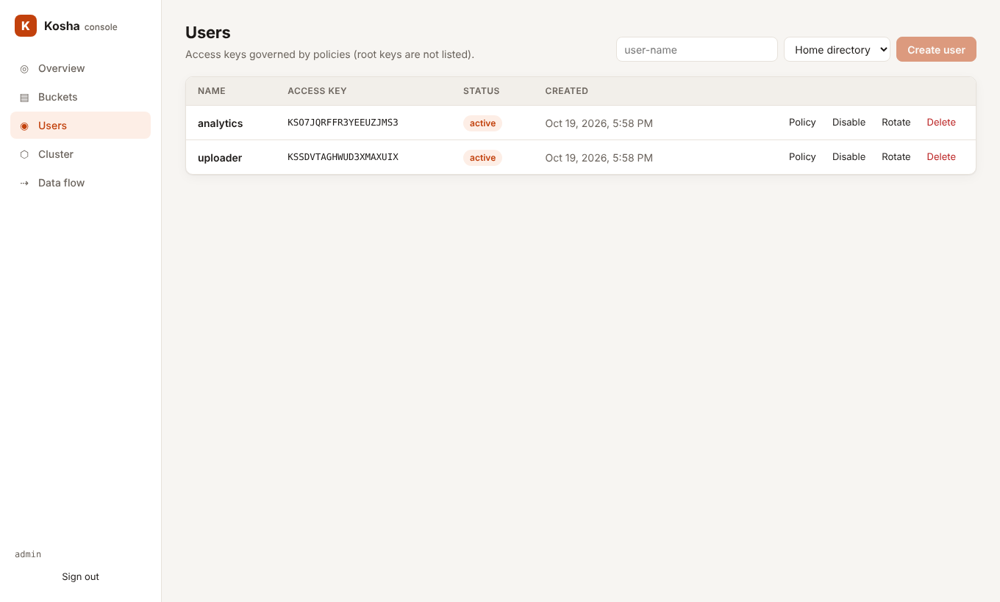

# Kosha

**Kosha** (कोश, "treasury") is an S3-compatible object store written in Rust.

It speaks the S3 API, so existing tools and SDKs work unchanged. Underneath, it is
not a clone of S3's design. Kosha stores data the way modern backup and
content-addressed systems do, replicates it with Raft, and drives the disk
with io_uring.


| Area | How Kosha does it |
|---|---|
| Unit of storage | **content-defined chunks** (FastCDC) |
| Identity | key → manifest of **BLAKE3**-addressed chunks |
| Duplicate data | **stored once, globally** (across objects, buckets, versions and multipart parts) |
| Server-side copy | **metadata only** (a 256 MiB copy took 2.9 ms in our benchmark) |
| Multipart complete | **concatenates manifests**, no data moved |
| Compression | **adaptive** zstd: probes each chunk, skips incompressible data |
| Integrity | **every chunk verified on every read**, including reads from other nodes |
| Disk I/O | **io_uring** for chunk reads and writes (falls back to a thread pool where it's unavailable), optional `O_DIRECT` |
| Metadata | **Raft-replicated ACID state machine** (openraft + redb) |
| Consistency | **linearizable** reads and writes on any node (leader lease, ReadIndex from followers) |
| Concurrency control | **conditional writes** (`If-None-Match: *`, `If-Match`) evaluated in the Raft log |
| Write path | **group commit**: concurrent writes share one durable transaction / one Raft entry |
| Redundancy | **replication or Reed–Solomon erasure coding** (e.g. 4+2: 1.5× storage, survives 2 failures) |
| Durability after node loss | **self-healing**: background re-replication restores every chunk's replica count |
| Internal retries | **applied once**: a write that one node retries to another (say, after a lost reply) returns its original result |
| Chunk durability | **group sync**: concurrent chunk writes share one `syncfs`, including the directory entry |
| Encryption at rest | **dedup-preserving**: keyed chunk addresses + deterministic AES-256-GCM-SIV |
| Cold data | **built-in cold tier**: chunks move to any S3 bucket, reads stay transparent, dedup preserved |
| Versions | **versions share chunks**: a new version stores only the chunks that changed |
| Hot vs cold | **access-based tiering**: unread objects move to the cold tier, the first read brings them back |
| Cold redundancy | **replicated while hot, erasure coded once cold**, in the background |
| Key rotation | **online**: data is re-encrypted in the background, chunk ids and dedup unchanged |
| Admin UI | **built-in web console**, compiled into the binary |

## Kosha vs Amazon S3

Kosha speaks the S3 API, so the AWS CLI, boto3 and the AWS SDKs work against
it unchanged (see [S3 compatibility](#s3-compatibility) for what is tested).
It is not a copy of Amazon S3, though: S3 is a managed service you rent, and
Kosha is software you run.

**Where Kosha differs**

| | Amazon S3 | Kosha |
|---|---|---|
| Where it runs | AWS Regions | your own machines or any cloud (Linux recommended) |
| What you pay | storage per GB-month, requests, and data transferred out | the hardware and network you provide; no per-request charges |
| Duplicate data | no deduplication: every object is stored and billed at its full size | each unique chunk is stored once, across all objects and buckets |
| Compression | none on the server: you are billed for the bytes you upload | adaptive zstd per chunk, transparent to clients |
| Server-side copy | the copy is a separate object, stored and billed at its full size | metadata only: the copy shares its chunks with the source |
| Versions | every retained version is billed | versions share chunks; a new version costs only its changed bytes |
| Encryption at rest | SSE-S3 (the default), SSE-KMS, DSSE-KMS, SSE-C | your own key file; encryption keeps deduplication; online key rotation; no KMS integration |
| Consistency | strong read-after-write; conditional writes with `If-None-Match` and `If-Match` | linearizable through Raft; the same conditional writes, evaluated in the Raft log |
| Cold storage | Glacier Instant Retrieval reads in milliseconds; Glacier Flexible Retrieval needs a restore that takes minutes to hours, Deep Archive up to 12 hours (48 for bulk) | a cold tier on *any* S3-compatible bucket; reads are transparent and `RestoreObject` completes at once |
| Intelligent-Tiering | a monthly monitoring fee for each object of 128 KB or more | built in, no fee; access is tracked in the replicated metadata |
| Redundancy | set by the storage class: at least three Availability Zones, or one for the One Zone classes | your choice per cluster: N replicas, or Reed–Solomon K+M (for example 4+2 = 1.5× storage) |
| Monitoring | CloudWatch: daily storage metrics free, request metrics billed | Prometheus metrics, `/_kosha/stats` and a built-in web console |
| Source | proprietary service | open source (Apache-2.0), one binary |

**What Amazon S3 has that Kosha does not**

- **Scale and durability as a service.** S3 is designed for 99.999999999%
  (11 nines) durability and is operated for you. A Kosha cluster is as
  durable and as available as the nodes, disks and sites you give it, and
  you operate it.
- **Metadata scale.** All Kosha metadata goes through one Raft group. In our
  benchmarks on a shared 4-core VM, a 3-node cluster sustained 1,180–1,430
  4 KiB PUTs per second. That is far below S3's scale (see the
  [roadmap](docs/ARCHITECTURE.md#roadmap)).
- **The wider AWS ecosystem.** Kosha has no AWS IAM API, roles or STS
  credentials (users are managed in the console or `/_kosha/admin/users`),
  no SSE-KMS or SSE-C, no ACLs that grant access to others (use policies),
  no cross-region replication, no static website hosting, and no S3
  Inventory or Storage Lens. Notifications go to webhooks, not SQS, SNS,
  Lambda or EventBridge. Unsupported operations return `501 NotImplemented`.

**When to choose which**

- **Choose Kosha** to keep data on your own hardware, to avoid per-request
  and egress charges, for data with many duplicates (backups, VM images,
  datasets, build artifacts, versioned documents), or for sites without
  cloud access.
- **Choose S3** when you want no operations work, AWS-managed durability at
  any scale, or integration with other AWS services.
- **Use both:** point Kosha's [cold tier](#cold-tier) at an S3 bucket.
  Hot data stays local, and cold chunks go to S3 already deduplicated,
  compressed and encrypted.

Sources (checked October 2026):
[S3 storage classes](https://aws.amazon.com/s3/storage-classes/),
[Glacier storage classes](https://docs.aws.amazon.com/AmazonS3/latest/userguide/glacier-storage-classes.html),
[S3 pricing](https://aws.amazon.com/s3/pricing/),
[conditional writes (If-None-Match)](https://aws.amazon.com/about-aws/whats-new/2024/08/amazon-s3-conditional-writes),
[conditional writes (If-Match)](https://aws.amazon.com/about-aws/whats-new/2024/11/amazon-s3-functionality-conditional-writes),
[billing for versions](https://docs.aws.amazon.com/AmazonS3/latest/userguide/aws-billing-reports.html),
[CloudWatch metrics](https://docs.aws.amazon.com/AmazonS3/latest/userguide/cloudwatch-monitoring.html).

## Kosha vs MinIO, RustFS and Garage

The self-hosted S3 servers closest to Kosha are MinIO (Go), RustFS (Rust)
and Garage (Rust). In one sentence each:

- **MinIO** and **RustFS** erasure code each object across a set of drives
  and keep its metadata (`xl.meta`) next to the data.
- **Garage** splits objects into fixed-size blocks and replicates them
  across sites, with no leader.
- **Kosha** splits data into content-defined chunks, stores each unique chunk
  once, and keeps all metadata in one Raft-replicated database.

Every statement about them was checked in October 2026 against their own
documentation or source code (linked below). For measured speed, see
[Compared with RustFS and MinIO](#compared-with-rustfs-and-minio): that
benchmark covers single-node, single-drive setups only. Garage was not
benchmarked.

| | MinIO | RustFS | Garage | Kosha |
|---|---|---|---|---|
| Language, license | Go, AGPLv3 | Rust, Apache-2.0 | Rust, AGPLv3 | Rust, Apache-2.0 |
| Status | community edition marked "no longer maintained" (last commit February 2026); source only, no binaries | 1.0.0 tagged 16 September 2026 | active; v2.4.1 released September 2026; in production at Deuxfleurs since 2020 | new; tested on a single VM, not yet run in production |
| Data layout | object erasure coded across a drive set; optional S2 compression | same model as MinIO; optional compression | fixed-size blocks, replicated; optional zstd | content-defined chunks (FastCDC), addressed by BLAKE3; adaptive zstd |
| Deduplication | none documented | none documented | identical blocks; an insert shifts every later block, so they stop matching | **global**, across objects, buckets, versions and parts; after an insert, most chunks still match |
| Metadata | `xl.meta` with each object; distributed locks (dsync) | same model as MinIO | CRDT tables with quorum reads and writes, no Raft | **one Raft-replicated database** (openraft + redb) |
| Consistency | strict read-after-write and list-after-write (on xfs, zfs or btrfs, per its docs) | not stated in its docs | read-after-write by default; can be relaxed with `consistency_mode` | **linearizable** on any node; conditional writes evaluated in the Raft log |
| Copy to a new key | data is rewritten (metadata only when copying onto itself) | data is rewritten (metadata only when copying onto itself) | metadata only in most cases: the copy references the same blocks | metadata only |
| Multipart complete | part files are renamed into place, no copy | part files are renamed into place, no copy | the parts' blocks are linked into the object, no copy | manifests are concatenated, no copy |
| New version of an object | stored in full | stored in full | no versioning | stores only the changed chunks |
| Redundancy | erasure coding | erasure coding | replication | replication or erasure coding, or replicated while hot and erasure coded once cold |
| Encryption at rest | SSE with a KMS through KES | SSE with a KMS (Vault, AWS KMS) | SSE-C (client-supplied keys) only | dedup-preserving encryption with your own key file, online rotation |
| Tiering | lifecycle transition to remote tiers (cloud or another MinIO) | lifecycle transition to remote S3 | none | chunk-level cold tier on any S3 bucket, access-based demotion and promotion |
| Disk I/O | `O_DIRECT` writes in multi-drive setups, on drives that support it | standard reads and writes; opt-in io_uring reads and `O_DIRECT` reads | standard reads and writes | io_uring for reads and writes; opt-in `O_DIRECT` |
| Web console | object browser; admin screens removed in 2025 | included | none in the project (CLI and admin API) | built into the binary |

**Where they are ahead of Kosha**

- **Maturity.** MinIO has been widely deployed for years, and Garage has run
  in production at Deuxfleurs since 2020. Kosha has no production history.
- **Metadata scale.** Every Kosha metadata write goes through one Raft
  leader: 1,180–1,430 4 KiB PUTs per second in our 3-node benchmarks on a
  shared 4-core VM. MinIO and RustFS keep metadata with each object instead
  of in a central database, and Garage has no leader, so none of them
  funnels metadata through one node.
- **Large uploads.** In our single-node benchmark MinIO uploaded 32 MiB
  objects faster than Kosha (161 vs 139 MiB/s median) and matched it on
  1 MiB uploads. Kosha also hashes every chunk and probes it for
  compression. Multi-drive erasure-coded setups, which MinIO and RustFS are
  built for, were not benchmarked.
- **Enterprise features.** RustFS has KMS integration (Vault, AWS KMS),
  OIDC single sign-on, site and bucket replication, S3 Select, bucket quotas,
  audit logging, Swift, WebDAV and FTPS access, opt-in SFTP, and S3 Tables
  with an Iceberg catalog (preview). Kosha has none of these.
- **Spread-out clusters.** Garage is designed for clusters spread over
  several sites, has no leader, and serves static websites. It lacks
  versioning, Object Lock, bucket policies and notifications, which Kosha
  has.

**Which one to pick**

- **Kosha:** data that repeats (backups, VM images, datasets, build
  artifacts, versioned documents). Also when you need linearizable
  consistency, or encryption at rest that keeps deduplication.
- **RustFS:** a maintained MinIO-style server with an enterprise feature set.
- **Garage:** a small, low-maintenance cluster spread over homes or sites.
- **MinIO:** existing deployments. The community edition is marked
  unmaintained and ships as source only, so you build and patch it yourself.

Sources (checked October 2026):
MinIO [README](https://github.com/minio/minio#readme),
[consistency](https://github.com/minio/minio/blob/master/docs/distributed/README.md),
[compression](https://github.com/minio/minio/blob/master/docs/compression/README.md),
[lifecycle transition](https://github.com/minio/minio/blob/master/docs/bucket/lifecycle/README.md),
[KMS](https://github.com/minio/minio/blob/master/docs/kms/README.md),
[CopyObject](https://github.com/minio/minio/blob/master/cmd/object-handlers.go),
[console change](https://blocksandfiles.com/2025/06/19/minio-removes-management-features-from-basic-community-edition-object-storage-code/);
RustFS [README](https://github.com/rustfs/rustfs#readme),
[disk I/O](https://github.com/rustfs/rustfs/blob/main/crates/ecstore/src/disk/local.rs),
[CopyObject](https://github.com/rustfs/rustfs/blob/main/rustfs/src/app/object/copy.rs);
Garage [S3 compatibility](https://garagehq.deuxfleurs.fr/documentation/reference-manual/s3-compatibility/),
[features](https://garagehq.deuxfleurs.fr/documentation/reference-manual/features/),
[consistency_mode](https://garagehq.deuxfleurs.fr/documentation/reference-manual/configuration/#consistency_mode),
[CopyObject](https://github.com/deuxfleurs-org/garage/blob/main-v2/src/api/s3/copy.rs).

**Contents:**
[Kosha vs S3](#kosha-vs-amazon-s3) ·
[vs MinIO, RustFS, Garage](#kosha-vs-minio-rustfs-and-garage) ·
[Install](#1-install) ·
[Run a server](#2-run-a-single-node) ·
[Read and write data](#3-read-and-write-data) ·
[Web console](#4-web-console) ·
[Cluster](#5-run-a-cluster) ·
[Monitoring](#6-monitoring) ·
[Security](#7-security) ·
[Performance](#performance) ·
[Fault testing](#fault-testing) ·
[Configuration](#configuration) ·
[S3 compatibility](#s3-compatibility) ·
[Architecture](docs/ARCHITECTURE.md)

---

## 1. Install

You need **Rust 1.85 or newer**. **Node.js 20 or newer** is optional and only
needed to build the web console. Linux is recommended (io_uring); other
platforms use the thread-pool I/O backend.

```sh
git clone https://github.com/piyooshsinha/Kosha && cd Kosha
(cd ui && npm ci && npm run build)   # optional: builds the console that gets embedded
cargo build --release                # produces ./target/release/kosha
```

## 2. Run a single node

```sh
export KOSHA_ACCESS_KEY=admin
export KOSHA_SECRET_KEY=change-me-please
./target/release/kosha --data-dir ./data --listen 0.0.0.0:9000
```

The log tells you which I/O backend was chosen and where the console is:

```
INFO kosha: storage engine ready io="io_uring"
INFO kosha: Kosha is ready listen=0.0.0.0:9000 console=http://0.0.0.0:9000/_kosha/ui/ mode="single-node"
```

Everything lives in `--data-dir`: `meta.redb` holds the metadata,
`chunks/` the content-addressed data, and `raft/` the Raft log in cluster
mode. Stop the server with Ctrl-C; it shuts down gracefully.

For local experiments you can skip authentication with `--anonymous`. Never
use it on a network you don't control.

## 3. Read and write data

Kosha works with S3 clients as-is. Point them at the server with path-style
addressing. Any region name is accepted.

### AWS CLI

```sh
export AWS_ACCESS_KEY_ID=admin AWS_SECRET_ACCESS_KEY=change-me-please AWS_DEFAULT_REGION=us-east-1
alias s3k='aws --endpoint-url http://localhost:9000 s3'

s3k mb s3://photos                                   # create a bucket
s3k cp ./holiday.jpg s3://photos/2026/holiday.jpg    # upload (large files use multipart automatically)
s3k ls s3://photos --recursive                       # list
s3k cp s3://photos/2026/holiday.jpg ./copy.jpg       # download
s3k sync ./website s3://photos/site/                 # sync a directory
s3k cp s3://photos/2026/holiday.jpg s3://photos/backup.jpg   # server-side copy: metadata only
s3k presign s3://photos/2026/holiday.jpg --expires-in 3600   # shareable link
s3k rm s3://photos/2026/holiday.jpg
```

### Versioning, Object Lock and lifecycle

```sh
alias s3api='aws --endpoint-url http://localhost:9000 s3api'

# Keep every version. Versions share chunks, so a new version costs only its changed bytes.
s3api put-bucket-versioning --bucket docs --versioning-configuration Status=Enabled
s3api list-object-versions --bucket docs --prefix report.txt
s3api get-object --bucket docs --key report.txt --version-id 0000000000000001 old.txt

# WORM: a COMPLIANCE-retained version cannot be deleted or shortened by anyone until it expires.
s3api create-bucket --bucket vault --object-lock-enabled-for-bucket
s3api put-object-lock-configuration --bucket vault --object-lock-configuration \
  '{"ObjectLockEnabled":"Enabled","Rule":{"DefaultRetention":{"Mode":"COMPLIANCE","Days":30}}}'
s3api put-object-legal-hold --bucket vault --key ledger.csv --legal-hold Status=ON

# Expire logs after 30 days, old versions after 7, abandoned uploads after 2.
s3api put-bucket-lifecycle-configuration --bucket docs --lifecycle-configuration \
  '{"Rules":[{"ID":"tidy","Status":"Enabled","Filter":{"Prefix":"logs/"},"Expiration":{"Days":30},
    "NoncurrentVersionExpiration":{"NoncurrentDays":7},"AbortIncompleteMultipartUpload":{"DaysAfterInitiation":2}}]}'
```

Lifecycle runs every `--lifecycle-interval-secs` (default one hour). Its
deletions go through the same replicated command path as client deletes, so
Object Lock still protects locked versions.

### Cold tier

Kosha can move cold data to any S3-compatible bucket (AWS S3, MinIO, or
another Kosha) and keep serving it transparently:

```sh
kosha --cold-tier-endpoint https://s3.eu-west-1.amazonaws.com --cold-tier-bucket my-archive \
      --cold-tier-region eu-west-1 --cold-tier-access-key AKIA… --cold-tier-secret-key … ...

# move objects after 30 days (and old versions after 7 with NoncurrentVersionTransitions)...
s3api put-bucket-lifecycle-configuration --bucket logs --lifecycle-configuration '{"Rules": [
  {"ID": "archive", "Status": "Enabled", "Filter": {"Prefix": "2025/"},
   "Transitions": [{"Days": 30, "StorageClass": "GLACIER_IR"}]}]}'
# ...or write straight to the cold tier
aws --endpoint-url http://localhost:9000 s3 cp backup.tar s3://logs/backup.tar --storage-class GLACIER_IR
```

- **Classes:** `STANDARD_IA`, `ONEZONE_IA`, `INTELLIGENT_TIERING`,
  `GLACIER_IR`, `GLACIER` and `DEEP_ARCHIVE` all mean "cold tier". GETs read
  through directly; there is no restore step. The class is reported by
  HEAD/GET and in listings.
- **Chunks, not objects, move.** A chunk leaves local disks only when every
  object using it is cold. Data shared with a STANDARD object stays local, and
  identical cold data is uploaded once.
- **What gets uploaded** is the chunk's stored bytes: compressed, and
  encrypted when encryption at rest is on. The cold provider never sees
  plaintext.
- **Reads** are verified against the content address, like every other read.
- **Deletes:** deleting the last object that uses a chunk deletes its remote
  copy.
- **Clusters:** the leader uploads, every node drops its local copies, and
  background repair leaves offloaded chunks alone.
- **Startup check:** Kosha writes and deletes a probe object, so a
  misconfigured tier fails immediately.
- `/_kosha/stats` and the console's Overview show the bytes in the cold tier.

**Access-based tiering.** Instead of fixed ages, let reads decide, through
S3's Intelligent-Tiering configuration API:

```sh
s3api put-bucket-intelligent-tiering-configuration --bucket media --id auto \
  --intelligent-tiering-configuration '{"Id": "auto", "Status": "Enabled",
    "Filter": {"Prefix": "videos/"},
    "Tierings": [{"Days": 90, "AccessTier": "ARCHIVE_ACCESS"}]}'
```

- **Demotion:** objects under the filter that nobody has read or written for
  `Days` move to the cold tier. They show as `INTELLIGENT_TIERING`.
- **Promotion:** the first GET of such an object serves it from the cold tier
  and, in the background, copies its chunks back to local disk and returns
  it to STANDARD.
- **Demoting again is free:** the remote copy is kept, so a promoted object
  that goes cold a second time is evicted again without another upload.
- **How reads are recorded:** each node collects reads in memory and records
  them as one replicated command every 30 seconds, so reads never wait on
  Raft. A crash can lose the last 30 seconds of read history, which only
  delays a demotion.
- Unlike AWS, `Days` may be any value from 1 upwards.
- Objects moved by lifecycle rules or uploaded with a cold class stay where
  they were put; only auto-tiered objects are promoted.

### Event notifications

Kosha posts S3-format event messages to webhooks when objects change. Name
the targets on the servers, then point buckets at them with the usual S3 API:

```sh
kosha --notify-webhook audit=https://hooks.example.com/kosha?token=… ...

s3api put-bucket-notification-configuration --bucket media --notification-configuration '{
  "QueueConfigurations": [{"Id": "uploads", "QueueArn": "arn:kosha:sqs::audit:webhook",
    "Events": ["s3:ObjectCreated:*", "s3:ObjectRemoved:*"],
    "Filter": {"Key": {"FilterRules": [{"Name": "prefix", "Value": "images/"}]}}}]}'
```

Each event is one `POST` with the standard
[S3 event message structure](https://docs.aws.amazon.com/AmazonS3/latest/userguide/notification-content-structure.html)
(`Records[0].eventName` is e.g. `ObjectCreated:Put`).

- **Event types:** `ObjectCreated:{Put,Copy,CompleteMultipartUpload}`,
  `ObjectRemoved:{Delete,DeleteMarkerCreated}`,
  `LifecycleExpiration:{Delete,DeleteMarkerCreated}`,
  `ObjectTagging:{Put,Delete}`, and their `*` forms.
- **Durability:** events are written to a replicated queue in the same
  transaction as the change. A crash, a restart or a new leader never loses
  one.
- **Order:** they are delivered in commit order, per target.
- **At least once:** a failing webhook is retried with backoff, and its
  queue holds up to 100,000 events. A leader crash between a delivery and its
  acknowledgement can repeat an event; deduplicate on
  `s3.object.sequencer`.
- **Verified:** in a 3-node test, the leader was SIGKILLed during 300
  uploads, and all 300 events arrived in order.


```python
import boto3

s3 = boto3.client(
    "s3",
    endpoint_url="http://localhost:9000",
    aws_access_key_id="admin",
    aws_secret_access_key="change-me-please",
    region_name="us-east-1",
)
s3.put_object(Bucket="photos", Key="hello.txt", Body=b"hi", ContentType="text/plain",
              Metadata={"owner": "me"})
print(s3.get_object(Bucket="photos", Key="hello.txt")["Body"].read())
s3.upload_file("big.iso", "photos", "isos/big.iso")          # multipart for large files
url = s3.generate_presigned_url("get_object", Params={"Bucket": "photos", "Key": "hello.txt"})

# Conditional create: succeeds only if the key does not exist yet (a simple lock).
s3.put_object(Bucket="photos", Key="locks/job-42", Body=b"", IfNoneMatch="*")
```

### Rust (aws-sdk-s3)

```rust
let conf = aws_sdk_s3::Config::builder()
    .behavior_version(aws_sdk_s3::config::BehaviorVersion::latest())
    .region(aws_sdk_s3::config::Region::new("us-east-1"))
    .endpoint_url("http://localhost:9000")
    .credentials_provider(aws_sdk_s3::config::Credentials::new("admin", "change-me-please", None, None, "kosha"))
    .force_path_style(true)
    .build();
let s3 = aws_sdk_s3::Client::from_conf(conf);
s3.put_object().bucket("photos").key("a.txt")
    .body(aws_sdk_s3::primitives::ByteStream::from_static(b"hello")).send().await?;
```

### curl

curl can sign requests itself:

```sh
curl --aws-sigv4 "aws:amz:us-east-1:s3" --user admin:change-me-please \
     -T ./report.pdf http://localhost:9000/photos/report.pdf
curl --aws-sigv4 "aws:amz:us-east-1:s3" --user admin:change-me-please \
     http://localhost:9000/photos/report.pdf -o report.pdf
```

## 4. Web console

Open **`http://<server>:9000/_kosha/ui/`** and sign in with the access key and
secret. The console talks to the ordinary S3 API: requests are SigV4-signed in
your browser, so there are no server-side sessions. It works over plain HTTP
too.

- **Overview**: object counts, logical vs on-disk size, and how much dedup and
  compression saved. Also shows the I/O backend and cluster role.
- **Buckets and object browser**: create and delete buckets, edit bucket
  policies, browse folders, drag-and-drop uploads with progress, object
  details, downloads, expiring share links (1 hour / 1 day / 7 days), and
  bulk delete.
- **Users** (root keys only): create users with a starting policy, show their
  keys once, edit policies, disable, rotate secrets, delete.
- **Cluster**: leader, Raft term, log and applied indexes, per-node
  replication progress, lease-read hit rate and background-repair counters,
  refreshed every 2 seconds. Nodes can be removed from here.

| Object browser | Cluster (dark mode) |
|---|---|
|  |  |



## 5. Run a cluster

Every node serves the full S3 API, so clients can use any node.

- **Metadata** is replicated through Raft.
- **Chunks** are stored on `--replication` nodes (default 2), chosen by
  rendezvous hashing.
- **Fault tolerance**: a 3-node cluster survives the loss of any one node.

On three machines (10.0.0.1–3):

```sh
# the same on every node
export KOSHA_ACCESS_KEY=admin KOSHA_SECRET_KEY=change-me-please
export KOSHA_CLUSTER_SECRET=<a long random string, e.g. openssl rand -hex 24>

# node 1 bootstraps the cluster
kosha --node-id 1 --data-dir /var/lib/kosha --listen 0.0.0.0:9000 \
      --cluster-listen 10.0.0.1:9100 --init

# nodes 2 and 3 join through any existing member
kosha --node-id 2 --data-dir /var/lib/kosha --listen 0.0.0.0:9000 \
      --cluster-listen 10.0.0.2:9100 --join 10.0.0.1:9100
kosha --node-id 3 --data-dir /var/lib/kosha --listen 0.0.0.0:9000 \
      --cluster-listen 10.0.0.3:9100 --join 10.0.0.1:9100
```

Things to know:

- `--init` and `--join` only matter the first time. A restarted node rejoins
  from its own Raft state, so the same command line is safe to reuse.
- Each node needs a unique `--node-id`, and `--cluster-listen` must be
  reachable from the other nodes. Behind NAT, set `--cluster-advertise` to
  the address peers should dial.
- **Writes** to a follower are forwarded to the leader. The follower answers
  only after it has applied the write itself, so you always read your own
  writes.
- **Reads** are linearizable on every node: a read never returns data older
  than a write that already completed anywhere in the cluster. The leader
  serves them from a **leader lease** instead of a quorum round-trip per read
  (in benchmarks, over 99% of read barriers). `--no-lease-reads` turns this
  off if your clocks are unreliable.
- **Failure**: if the leader dies, the others elect a new one within about
  1–2 seconds and keep serving. When the dead node comes back, it catches up
  from the log, or from a snapshot if the log was compacted.
- **Self-healing**: every node runs a background repairer
  (`--repair-interval-secs`, default 60). When a node stops answering, the
  next-ranked live nodes copy the chunks it held, so every chunk gets back to
  `--replication` copies without waiting for reads. Surplus copies, for
  example fallback replicas written while a node was down, are removed once
  the designated nodes confirm they have theirs.
- **Removing a node**: click **Remove** in the console's Cluster page, or
  call `DELETE /_kosha/cluster/nodes/<id>` (SigV4-signed) on any node. Then
  stop that node's process. Its data is re-replicated in the background.
- Internal traffic (port 9100) is authenticated by the shared secret. Without
  `--cluster-tls-*` it is plain HTTP, so **either enable mutual TLS
  ([Security](#cluster-mutual-tls)) or keep it on a private network.**

### Erasure coding

By default each chunk is stored as `--replication` full copies. With
`--erasure K+M` (the same on every node), chunks of at least
`--erasure-min-chunk` bytes (default 128 KiB) are instead split into K data
and M parity shards on K+M different nodes. Any K shards rebuild the chunk.

| | Storage | Survives |
|---|---|---|
| `--replication 2` | 2× | 1 failed node |
| `--replication 3` | 3× | 2 failed nodes |
| `--erasure 2+1` | 1.5× | 1 failed node |
| `--erasure 4+2` | 1.5× | 2 failed nodes |
| `--erasure 8+3` | 1.375× | 3 failed nodes |

- **What gets split** is the chunk's stored form, already compressed and
  encrypted. Every shard carries a BLAKE3 checksum, so a damaged shard is
  detected and treated as missing.
- **Healthy reads** fetch only the K data shards and concatenate them, with
  no decoding.
- **Degraded reads** use parity, and the result is verified against the
  chunk's address.
- **Repair:** when a node dies, the next node in the chunk's ranking rebuilds
  its shards from any K others. Only that node's shards move, and the
  repaired data is re-verified like everything else.
- **Small chunks**, and clusters with fewer than K+M nodes, use replication.
  Reads try both layouts, so changing the setting later is safe.
- **For self-healing**, run at least K+M+1 nodes, so a failed node's shards
  have somewhere to go.
- A node with a different `--erasure` setting is refused when it joins.

**Hot replicated, cold erasure coded.** With `--erasure K+M
--erasure-cold-only`:

- **Writes** stay replicated, so hot reads come from a full copy.
- **When a chunk goes cold** (every object using it is in a cold class, via
  lifecycle, a cold upload, or access-based tiering), the leader converts it
  to shards in the background, and every node drops its full copy.
- **No external tier needed:** this is the cold tier when no
  `--cold-tier-endpoint` is configured, so cold storage classes and
  Intelligent-Tiering work without one.
- **Reads** use the layout recorded in metadata, so hot reads never probe
  for shards.
- **Tested:** in a 6-node test, an object went from 2 replicas (2×) to 3+2
  shards (1.67×). It read correctly on every node, and repair rebuilt a dead
  node's shards.

Measured on 4 nodes (24 × 16 MiB objects, same VM, alternating runs):

| | Disk used | PUT | GET |
|---|---|---|---|
| `--replication 2` | 774 MB | 97–101 MiB/s | 681–693 MiB/s |
| `--erasure 2+1` | **585 MB** (−24%) | 95–106 MiB/s | 550–571 MiB/s |

GETs are ~18% slower because every chunk is gathered from two nodes; writes
are unchanged.

In a test, a node was SIGKILLed while holding 50 MB of 2+1 data. Reads stayed
correct, and repair rebuilt its 33 shards on the remaining nodes (back to
1.5×).

### Try a cluster on one machine

```sh
scripts/dev-cluster.sh start      # 3 nodes: S3 on :9001-9003, console on http://127.0.0.1:9001/_kosha/ui/
scripts/dev-cluster.sh kill 1     # SIGKILL node 1 and watch a new leader take over
scripts/dev-cluster.sh restart 1  # it rejoins and catches up
scripts/dev-cluster.sh stop

# remove a node for good (any node accepts the request)
curl -X DELETE --aws-sigv4 "aws:amz:us-east-1:s3" --user admin:admin-secret-key \
     http://127.0.0.1:9001/_kosha/cluster/nodes/3
```

## 6. Monitoring

| Endpoint | Auth | Returns |
|---|---|---|
| `GET /_kosha/health` | none | `ok`, for load balancer and liveness probes |
| `GET /_kosha/stats` | SigV4 | objects, logical/unique/physical bytes, dedup and compression ratios, I/O backend |
| `GET /_kosha/metrics` | SigV4, or none with `--metrics-public` | Prometheus: requests and latency histograms per S3 operation, bytes in/out, storage gauges, group commit/sync batching, Raft state, follower lag, lease/quorum reads, repair counters, pending/delivered/failed events |
| `GET /_kosha/cluster` | SigV4 | role, term, leader, log/applied indexes, members, replication progress, lease vs quorum reads, background repair counters |
| `DELETE /_kosha/cluster/nodes/{id}` | SigV4 | removes a voter (refuses non-voters and the last voter) |
| `/_kosha/admin/users[/{key}]` | SigV4 | user management (see [Security](#users-and-policies)) |

Every `/_kosha/` endpoint except `health` (and `metrics` with
`--metrics-public`) requires a **root** key; user keys get `403`.

```sh
curl -s --aws-sigv4 "aws:amz:us-east-1:s3" --user admin:change-me-please http://localhost:9000/_kosha/stats
# {"io_backend":"io_uring","buckets":2,"objects":7,"logical_bytes":832569357,"unique_bytes":292552704,
#  "physical_bytes":292552944,"chunks":240,"dedup_ratio":2.846,"compression_ratio":1.000,"overall_ratio":2.846}
```

Prometheus scrape config:

```yaml
scrape_configs:
  - job_name: kosha
    metrics_path: /_kosha/metrics
    static_configs: [{ targets: ["10.0.0.1:9000", "10.0.0.2:9000", "10.0.0.3:9000"] }]
```

(start the nodes with `--metrics-public`). Logs go to stderr and are
filtered with `RUST_LOG`. Per-request lines are at debug level, for example
`RUST_LOG=kosha_s3=debug`; at the default level the metrics are the
per-request record.

## 7. Security

### Users and policies

The keys from `KOSHA_ACCESS_KEY` / `KOSHA_SECRET_KEY` are **root** keys: they
bypass policies. Everyone else gets a **user** with its own access key, whose
permissions come from IAM-style policies. Users are stored in the replicated
metadata, so every node authenticates them.

```sh
alias kadmin='curl -s --aws-sigv4 "aws:amz:us-east-1:s3" --user admin:change-me-please'

# create a user with an identity policy; the response carries its keys (shown once)
kadmin -X POST http://localhost:9000/_kosha/admin/users -H 'content-type: application/json' -d '{
  "name": "analytics",
  "policy": {"Version": "2012-10-17", "Statement": [
    {"Effect": "Allow", "Action": ["s3:GetObject", "s3:ListBucket"],
     "Resource": ["arn:aws:s3:::reports", "arn:aws:s3:::reports/*"]}]}}'
# {"access_key":"KS4VUIBFMF75WK64R7EL","secret_key":"…","name":"analytics",…}

kadmin http://localhost:9000/_kosha/admin/users                          # list (no secrets)
kadmin -X PUT http://localhost:9000/_kosha/admin/users/KS4V… -d '{"enabled": false}'
kadmin -X PUT http://localhost:9000/_kosha/admin/users/KS4V… -d '{"rotate_secret": true}'
kadmin -X DELETE http://localhost:9000/_kosha/admin/users/KS4V…
```

**Bucket policies** use the same language plus `Principal`. `"Principal": "*"`
grants anonymous (unsigned) access, which is how you publish a static site or
a download area:

```sh
aws --endpoint-url http://localhost:9000 s3api put-bucket-policy --bucket site --policy '{
  "Version": "2012-10-17",
  "Statement": [
    {"Effect": "Allow", "Principal": "*", "Action": "s3:GetObject", "Resource": "arn:aws:s3:::site/*"},
    {"Effect": "Allow", "Principal": {"AWS": ["arn:aws:iam:::user/analytics"]},
     "Action": "s3:PutObject", "Resource": "arn:aws:s3:::site/uploads/*",
     "Condition": {"IpAddress": {"aws:SourceIp": "10.0.0.0/8"}}}]}'
curl http://localhost:9000/site/index.html        # no signature needed now
```

What the policy language supports:

| | |
|---|---|
| Statements | `Effect`, `Action`/`NotAction`, `Resource`/`NotResource` with `*` and `?`, `Principal` (`"*"`, user names, `arn:…:user/NAME`, access keys) |
| Variables | `${aws:username}`, `${aws:userid}` and any condition key, e.g. `arn:aws:s3:::home/${aws:username}/*` |
| Conditions | `String(Not)Equals(IgnoreCase)`, `String(Not)Like`, `Numeric*`, `(Not)IpAddress`, `Bool`, `Null`, `…IfExists`, `ForAnyValue:`/`ForAllValues:` |
| Condition keys | `aws:SourceIp`, `aws:SecureTransport`, `aws:username`, `aws:userid`, `aws:PrincipalType`, `aws:UserAgent`, `aws:Referer`, `aws:CurrentTime`, `aws:EpochTime`, `s3:prefix`, `s3:delimiter`, `s3:max-keys`, `s3:VersionId`, `s3:x-amz-server-side-encryption`, `s3:signatureversion`, `s3:authType`, … |
| Evaluation | an explicit `Deny` anywhere wins; otherwise an `Allow` in the identity **or** the bucket policy grants access; otherwise `AccessDenied` |

Every S3 operation maps to its IAM action (`s3:GetObject`,
`s3:ListBucket`, `s3:PutBucketPolicy`, …). `DeleteObjects` is checked key by
key, copies also need `s3:GetObject` on the source, and without
`s3:ListBucket` a missing key reads as `AccessDenied`, so callers cannot probe
which keys exist. Invalid policies are rejected with `MalformedPolicy` when
you set them.

### HTTPS

```sh
kosha --tls-cert server.pem --tls-key server.key ...   # serves S3 and the console over HTTPS
aws --endpoint-url https://s3.example.internal:9000 s3 ls
```

`aws:SecureTransport` is `true` for requests that arrive over TLS.

### Cluster mutual TLS

Give every node a certificate from your own CA. The certificate's SANs must
cover the address peers dial (`--cluster-advertise`, an IP or a DNS name):

```sh
openssl req -x509 -newkey ec -pkeyopt ec_paramgen_curve:P-256 -nodes -days 3650 \
  -keyout ca.key -out ca.pem -subj "/CN=Kosha CA"
openssl req -newkey ec -pkeyopt ec_paramgen_curve:P-256 -nodes \
  -keyout node1.key -out node1.csr -subj "/CN=node1"
openssl x509 -req -in node1.csr -CA ca.pem -CAkey ca.key -CAcreateserial -days 825 -out node1.pem \
  -extfile <(printf "subjectAltName=IP:10.0.0.1\nextendedKeyUsage=serverAuth,clientAuth")

kosha --node-id 1 ... --cluster-tls-cert node1.pem --cluster-tls-key node1.key --cluster-tls-ca ca.pem
```

All internal traffic (Raft, chunk replication, repair) then runs over TLS,
and each side verifies the other: a peer without a certificate from that CA
is refused before it can send anything, even if it knows the cluster
secret.

### Encryption at rest

```sh
openssl rand -hex 32 > /etc/kosha/kosha.key && chmod 600 /etc/kosha/kosha.key
kosha --encryption-key-file /etc/kosha/kosha.key ...
```

Object data is encrypted on disk **without giving up dedup**:

- **Chunk addresses** are a *keyed* BLAKE3 hash. Identical content still maps
  to one chunk, but someone with the disks cannot check whether a known file
  is stored by hashing it.
- **Chunk contents** are compressed, then encrypted with AES-256-GCM-SIV. The
  nonce is derived from the chunk address, so encryption is deterministic:
  replicas stay byte-identical and repair can compare them. GCM-SIV is
  designed to stay secure when the same plaintext meets the same nonce.
- **Every read is authenticated**: a modified chunk fails decryption.
- **Small objects are encrypted too.** They are stored as chunks instead of
  inline in the metadata.

Other things to know:

- **Choose encryption when you create a data directory.** Kosha records the
  data directory's encryption identity. It refuses to start without a key
  that can open it, without any key, or with a key on a directory that
  already holds unencrypted data.
- **Every cluster node needs the same key.** A node with another key, or none,
  is refused when it joins.
- **Back up the key.** Without it the data cannot be read (see rotation
  below).
- `x-amz-server-side-encryption: AES256` is returned on object responses, and
  GetBucketEncryption reports SSE-S3.
- **Refused, not ignored:** on a server without a key, a request for SSE is
  refused rather than stored in plaintext. SSE-KMS and SSE-C (customer keys)
  return `NotImplemented`.
- **Not encrypted:** metadata (bucket and key names, sizes, tags, user
  metadata, users' secret keys) stays readable in `meta.redb` and the Raft
  log. Treat the data directory as sensitive.
- **Cost:** see [Performance](#cost-of-encryption-at-rest).

**Rotating keys.** Give every node the new key as primary and the current one
as an old key, then restart them one at a time:

```sh
openssl rand -hex 32 > /etc/kosha/kosha-2027.key
kosha --encryption-key-file /etc/kosha/kosha-2027.key \
      --encryption-old-key-file /etc/kosha/kosha.key ...
curl -s --aws-sigv4 ... http://localhost:9000/_kosha/stats   # "rotation": {"chunks_pending": 0, ...}
```

- **New data** uses the new key immediately.
- **Existing data** is re-encrypted in the background: every node rewrites
  its chunk files and shards, and the leader re-uploads cold-tier copies.
  Every encrypted chunk records which key sealed it.
- **Progress** is in `/_kosha/stats` (`rotation`) and Prometheus
  (`kosha_rotation_pending`).
- **When every node reports 0 pending**, drop `--encryption-old-key-file`.
  The old key is then no longer needed for anything.
- **Chunk ids stay valid.** The key that hashes chunk ids never changes:
  it's created with the data directory and kept in `chunks/ID_KEY`, sealed
  under the current primary key.
- **New nodes joining a rotated cluster** need the cluster's original key
  once: `--encryption-identity-key-file`.
- **Legacy shards:** erasure-coded shards written by versions before this
  one in an encrypted cluster use the old shard format. They are counted as
  `legacy_shards`, can only be read with their original key, and are not
  re-encrypted. Rewrite those objects (for example with a server-side copy)
  to move them to the new format.

---

## Performance

All numbers come from the 4-core / 15 GB development VM, with **the load
generator and every server process sharing those same 4 cores**. In the
cluster runs, three Kosha nodes and the client run on one machine. Treat the
numbers as a floor: on dedicated hardware the server gets all the CPU, and
cluster nodes stop competing with each other.

Unless noted otherwise:
- fsync is on, the I/O backend is io_uring, and objects are random
  (incompressible and unique, so dedup cannot help);
- the client is the official **AWS SDK for Rust**, which signs every payload
  with SHA-256;
- every GET is checked byte-for-byte against what was written, and every run
  finished with **0 errors**.

### Group commit and lease reads: before and after

Measured back-to-back on the same VM, same client, same workload
(4 KiB objects, 32 concurrent requests unless noted):

| | Before | After | |
|---|---|---|---|
| Single node, PUT | 987 req/s · p50 31 ms | **3,193 req/s** · p50 6.4 ms | **3.2×** |
| Single node, PUT at 128 concurrent | 895 req/s · p50 140 ms | **3,209 req/s** · p50 21 ms | **3.6×** |
| 3-node cluster, PUT via leader | 529–626 req/s · p50 ~50 ms | **1,432 req/s** · p50 19 ms | **2.3–2.7×** |
| 3-node cluster, PUT via follower | 638 req/s | **1,220 req/s** | **1.9×** |
| Leader read barriers needing a quorum round-trip | 100% | **0.2%** (31 of 17,200) | lease |
| Leader GET, one request at a time | p50 1.15 ms | **p50 0.87 ms** | −24% |

- **Before group commit**, throughput stayed flat from 32 to 128 concurrent
  requests while latency grew, the signature of a serialized commit path. On
  the cluster leader, a probe showed every Raft append carried exactly one
  entry.
- **Now**, single-node writes form batches in one durable redb transaction,
  and cluster writes put a batch of commands into one Raft entry. Batches
  form from load alone, so a lone request still commits immediately.
- **Lease reads** save one quorum round-trip per read on the leader, and a
  follower read now costs a single round-trip to the leader. On loopback a
  round-trip is ~0.3 ms, so the gain here is small. Across racks or
  availability zones it is a full network RTT per read.

### Single node: throughput under load

| Object size | Concurrency | PUT | GET |
|---|---|---|---|
| 4 KiB | 32 | **2,760 req/s** · p50 6.9 ms | **3,900 req/s** · p50 4.3 ms · p99 9.9 ms |
| 4 KiB | 128 | **2,830 req/s** · p50 24 ms | 2,650 req/s · p50 22 ms |
| 64 KiB | 32 | **840 req/s** (53 MiB/s) · p50 28 ms | **3,000 req/s** (188 MiB/s) · p50 7.5 ms |
| 1 MiB | 16 | **121 MiB/s** · p50 84 ms | **693 MiB/s** · p50 20 ms · p99 44 ms |
| 32 MiB | 4 | **117 MiB/s** · p50 962 ms | **562 MiB/s** · p50 217 ms |

### Single node: one request at a time (latency)

| Object size | PUT p50 / p99 | GET p50 / p99 |
|---|---|---|
| 4 KiB | **3.0 ms** / 8.6 ms | **0.77 ms** / 2.1 ms |
| 1 MiB | 19 ms / 29 ms | **4.2 ms** / 9.9 ms |

### Single node: one large stream (curl, `UNSIGNED-PAYLOAD`)

| Operation | Result |
|---|---|
| PUT 256 MiB, unique data | 245–340 MB/s (two runs) |
| PUT 256 MiB, data already stored (dedup) | 342 MB/s |
| GET 256 MiB (chunks still in page cache) | **1.14–1.17 GB/s** |
| Server-side COPY 256 MiB | **2.9 ms** (metadata only) |

### 3-node cluster (replication factor 2)

Writes go through Raft: a batch of commands becomes one log entry, which the
leader fsyncs and replicates to a majority. Each chunk is also written to 2
nodes. Follower reads make one round-trip to the leader; the leader answers
from its lease.

| Object size | Concurrency | PUT via leader | GET via follower |
|---|---|---|---|
| 4 KiB | 32 | **1,180 req/s** · p50 23 ms · p99 41 ms | **3,700 req/s** · p50 5.5 ms · p99 25 ms |
| 64 KiB | 32 | **416 req/s** (26 MiB/s) · p50 67 ms | **2,440 req/s** (153 MiB/s) · p50 9.6 ms |
| 1 MiB | 16 | **93 MiB/s** · p50 133 ms | **678 MiB/s** · p50 21 ms |
| 32 MiB | 4 | **99 MiB/s** | **299 MiB/s** |

Through a follower, 4 KiB PUTs run at 1,100 req/s. With one request at a
time:

- 4 KiB PUT: **7.7 ms** p50.
- Linearizable 4 KiB GET on a follower: **1.1 ms** p50.
- 4 KiB GET on the leader, served from its lease: **0.72 ms** p50.

Run-to-run variance on this shared VM is about ±15% for most rows, more for
large objects in the cluster.

### What limits these numbers now

- **Large writes are CPU-bound on this VM.** The SDK hashes every payload
  with SHA-256, and the server re-verifies it and also computes MD5 (for the
  ETag) and BLAKE3 (for the chunk address), on the same 4 cores as the client
  (and, in the cluster, two other nodes). Identical-content 1 MiB PUTs, where
  dedup skips the disk write entirely, are only modestly faster
  (164 vs 143 MiB/s in an earlier run). The single-stream curl upload with
  `UNSIGNED-PAYLOAD` skips the SHA-256 and reaches 245–340 MB/s.
- **Chunk durability is not the limit.** Each chunk is written to a temp
  file, renamed into place, and made durable *together with its directory
  entry* before the PUT is acknowledged. With `--sync group` (the default)
  concurrent writers share one `syncfs`. Measured on 64 KiB PUTs:
  `group` 860–904 req/s, `none` (no sync at all) 772–886 req/s,
  `file` (fsync each file and directory) 736–749 req/s. Correct durability is
  therefore effectively free. An earlier version of this README guessed that
  per-chunk fsync limited 64 KiB writes; the `none` row shows the limit is
  CPU.
- **Small writes** now run at about the same rate as small reads, so the
  client, the HTTP stack and SigV4 verification share the remaining cost.

### Compared with RustFS and MinIO

All three servers ran on the same VM (4 cores shared with the client, 15 GB
RAM, ext4 on a virtio disk), one at a time, each with a fresh data
directory on the same disk and the same client: `s3bench` (AWS SDK for
Rust, which signs every payload with SHA-256), writing random objects and
checking every GET byte for byte (the same client as in the sections
above). There were three rounds: the first in the order Kosha, RustFS,
MinIO, the other two in reverse. The table shows the median and, in
brackets, the range. Every run finished with **0 errors**.

- **Versions:** Kosha built from this repository (server code as of commit
  `31df1b3`); RustFS 1.0.1 (official release
  binary); MinIO built from its final community commit (February 2026).
- **Setup:** single node, single drive, default settings. In single-drive
  mode MinIO and RustFS do not erasure code, and Kosha does not replicate,
  so none of the three has redundancy here. Multi-drive and multi-node
  setups were not measured.
- **Durability as configured by default** (read from each project's
  source): Kosha syncs chunk data, directory entries and metadata before
  acknowledging (`--sync group`). RustFS's default `strict` mode does the
  same. MinIO `fdatasync`s each data file but not directory entries.

| Workload | Kosha | RustFS | MinIO |
|---|---|---|---|
| PUT 4 KiB, 32 concurrent | **2,770** req/s [2,711–2,892] · p50 6.8 ms | 657 req/s [595–669] · p50 46 ms | 923 req/s [915–1,087] · p50 30 ms |
| GET 4 KiB, 32 concurrent | **3,810** req/s [3,768–4,122] | 3,210 req/s [3,120–3,428] | 3,171 req/s [2,936–3,303] |
| PUT 64 KiB, 32 concurrent | **1,104** req/s [1,084–1,111] | 508 req/s [484–537] | 765 req/s [763–873] |
| GET 64 KiB, 32 concurrent | **3,222** req/s [3,164–3,552] | 1,941 req/s [1,877–2,084] | 2,664 req/s [2,598–2,737] |
| PUT 1 MiB, 16 concurrent | 132 MiB/s [131–139] | 108 MiB/s [106–108] | 135 MiB/s [127–136] |
| GET 1 MiB, 16 concurrent | **959** MiB/s [872–1,058] | 792 MiB/s [753–804] | 795 MiB/s [764–806] |
| Server-side COPY 1 MiB, 16 concurrent | **3,207** copies/s [3,019–3,796] · p50 4.0 ms | 159 copies/s [148–163] · p50 102 ms | 199 copies/s [196–210] · p50 74 ms |
| PUT 32 MiB, 4 concurrent | 139 MiB/s [138–145] | 135 MiB/s [132–142] | **161** MiB/s [159–162] |
| GET 32 MiB, 4 concurrent | 556 MiB/s [535–568] | 516 MiB/s [464–549] | 531 MiB/s [522–545] |
| Disk used by 1,000 identical 1 MiB objects | **0 MiB** (already stored) | 1,000 MiB | 1,000 MiB |
| Data directory after every workload | **2.8 GiB** | 4.6 GiB | 4.6 GiB |
| Peak server memory (RSS) | **345–365 MiB** | 720–769 MiB | 627–630 MiB |

What the numbers show, and what they don't:

- **Small writes** are where Kosha leads most: at 4 KiB, 4–4.9× RustFS
  and 2.5–3.2× MinIO; at 64 KiB, about 2.2× and 1.4×. Group commit lets concurrent writes share one durable
  transaction and one `syncfs`. Under `strace`, 500 4 KiB PUTs plus
  100 1 MiB PUTs cost Kosha 343 sync calls and MinIO 600.
- **RustFS's durability mode is not the main cost.** With
  `RUSTFS_DURABILITY_MODE=relaxed`, which RustFS documents as matching
  MinIO's default (we confirmed it cut sync calls 7× for 500 PUTs), RustFS
  reached 761 req/s at 4 KiB and 622 req/s at 64 KiB in one round.
- **Large uploads** are limited by CPU: the client's SHA-256 signing and
  the servers' own hashing share the same 4 cores. MinIO is fastest at
  32 MiB and level with Kosha at 1 MiB.
- **Copies** in Kosha are metadata only. RustFS and MinIO rewrite the data
  when copying to a new key.
- **Deduplication** is the best case here: identical objects. Real data
  deduplicates less, and random data (every other row) not at all.
- **GETs** read data written moments earlier, so they mostly come from the
  page cache.
- **ext4.** MinIO's documentation recommends XFS and warns that ext4 does
  not honour all of its consistency assumptions. These results are for
  ext4 only.

Reproduce (RustFS and MinIO binaries are not included):

```sh
cargo build --release --bins --examples
GOBIN=$PWD/bin go install github.com/minio/minio@latest   # MinIO is source-only
# RustFS: download a release binary from github.com/rustfs/rustfs/releases
BENCH_DIR=/path/on/the/disk/to/test scripts/compare-bench.sh \
  target/release/kosha ./rustfs ./bin/minio 3
```

### Cost of encryption at rest

Same VM, single node, back-to-back runs with and without
`--encryption-key-file`:

| Workload | Plain | Encrypted | |
|---|---|---|---|
| 4 KiB PUT, 32 concurrent | 3,260 req/s | 1,300 req/s | small objects become chunk files instead of inline metadata |
| 4 KiB GET, 32 concurrent | 4,450 req/s | 3,860 req/s | |
| 64 KiB PUT / GET | 940 / 3,210 req/s | 1,064 / 3,180 req/s | within noise |
| 16 MiB PUT / GET, 4 concurrent | 139 / 875 MiB/s | 146 / 667 MiB/s | decryption costs ~24% on large reads |

These runs also found a bug that affected unencrypted servers too. The S3
listener did not set `TCP_NODELAY`, so objects stored as chunks but smaller
than a few TCP segments waited ~40 ms on Nagle's algorithm and delayed ACKs.
Encrypted 4 KiB GETs went from 714 to 3,860 req/s with the fix. Every
listener now sets it.

### Reproduce

```sh
cargo build --release --bins --examples
AWS_ACCESS_KEY_ID=admin AWS_SECRET_ACCESS_KEY=change-me-please \
  ./target/release/examples/s3bench --endpoint http://127.0.0.1:9000 \
  --size 64KiB --count 3000 --concurrency 32
# cluster: --endpoint http://127.0.0.1:9001 --read-endpoint http://127.0.0.1:9003
# dedup:   add --duplicate to upload identical content
# copy:    add --copy for a phase that server-side copies every object
```

`s3bench` writes `count` objects, reads them all back, verifies the content,
and prints req/s, MiB/s, p50/p99/max latency and errors for each phase.

### io_uring vs thread pool

On Linux, chunk files are read and written through io_uring. One ring per
core (up to 8), each driven by its own thread, runs every file operation as a
small state machine: `openat → write → fsync → close` or
`openat → read → close`. Hashing and compression stay on the blocking pool.
`cargo run --release -p kosha-engine --example iobench` compares the two
backends directly on chunk-sized files. One run with 4 rings:

| Workload | Threads | io_uring |
|---|---|---|
| 4 KiB writes | 10.9k ops/s | **45.8k ops/s** (4.2×) |
| 4 KiB writes + fsync | 8.5k ops/s | **10.3k ops/s** (1.2×) |
| 4 KiB reads | 112k ops/s | **147k ops/s** (1.3×) |
| 1 MiB writes | 416 MB/s | **658 MB/s** (1.6×) |
| 1 MiB writes + fsync | 413 MB/s | **651 MB/s** (1.6×) |
| 1 MiB reads (page cache) | 4.8 GB/s | **6.2 GB/s** (1.3×) |

Results vary between runs on a shared VM. Across repeated runs, 1 MiB + fsync
ranged from 1.6× to 3.1× in io_uring's favour. With fewer rings than cores,
page-cache reads can be *slower* than the thread pool, because they complete
inline on the ring thread. That is why Kosha defaults to one ring per core.

#### Direct I/O for large chunks (`--io-direct`)

With `--io-direct`, chunk files of at least `--io-direct-min` bytes (default
256 KiB) are written and read with `O_DIRECT`, bypassing the page cache. Each
ring has a pool of 4 KiB-aligned buffers, registered with the kernel
(`READ_FIXED`/`WRITE_FIXED`) when the locked-memory limit allows and used as
plain aligned buffers otherwise. A write sends its aligned prefix directly and
the unaligned tail through the page cache. If the filesystem refuses
`O_DIRECT` (tmpfs, some overlay setups), the ring turns it off and carries on
buffered. When every buffer is busy, a request goes through the page cache;
`kosha_direct_fallbacks_total` counts these.

On this VM (virtio disk, ext4) direct I/O is **not faster**. Per run, with
1 MiB files and the page cache dropped before each pass (`COLD=1`, see
`iobench`):

| 1 MiB files | io_uring | io_uring + `--io-direct` |
|---|---|---|
| writes + fsync | 570–620 MB/s | 390–410 MB/s |
| reads (cold cache) | 1.7–2.0 GB/s | 1.3–2.0 GB/s |
| page cache left by 1.5 GB of writes and reads | 1.5 GB | 0.15 GB (from fallbacks) |

What it buys is cache isolation. Large chunk traffic no longer evicts the
metadata database and the small, hot chunks from memory, and the node's
memory use does not grow with the data it streams. Turn it on for storage
nodes on fast NVMe that move mostly large objects. Leave it off (the default)
otherwise, in particular for workloads that re-read the same large objects,
which the page cache would serve.

Docker's default seccomp profile and `kernel.io_uring_disabled` block
io_uring. `--io auto` (the default) detects this and falls back to threads;
`/_kosha/stats` and the console report which backend is active.

---

## Fault testing

Three test programs check Kosha under faults: process crashes, power cuts,
and network partitions with clock drift. Each one also checks that it
really catches the faults it looks for: crashing on purpose, deleting data,
or (for partitions) driving a clock far enough out of spec to cause stale
reads. The results below are from the 4-core development VM, with the
server code at this commit.

### Process crashes (`crashtest`)

```sh
cargo build --release --bins --examples
target/release/examples/crashtest --kosha target/release/kosha --rounds 50
target/release/examples/crashtest --kosha target/release/kosha --cluster --chaos --rounds 30
# pass server flags after --, e.g. -- --erasure 2+1 or -- --encryption-key-file key.hex
```

Twelve writers each own 16 keys and change them one operation at a time:
PUTs from 0 bytes to 12 MiB (inline objects, chunk boundaries, multipart
uploads, partly shared content so deduplicated chunks are exercised),
DELETEs and server-side COPYs. Every round kills a server with `SIGKILL`
at a random moment, restarts it, and then checks every key on every node,
twice:

- an acknowledged operation must be visible, byte for byte;
- an operation that failed or was cut off may be visible or not, but never
  half-applied. It may also appear later, because Raft can still commit
  its log entry after a restart, but never after a later acknowledged
  write to the same key;
- all nodes must agree, and listings must show exactly the keys that exist.

In a cluster, writers keep writing to the surviving nodes while one is
down. With `--chaos`, a third of the rounds kill two of the three nodes
(losing the majority), and a third crash a node again while it recovers.
`--sabotage` deletes a chunk file after each crash, to show that the test
does catch lost data.

| Setup | Crashes | Acknowledged operations | Errors |
|---|---|---|---|
| Single node, default | 50 | 50,625 | **0** |
| Single node, `--sync file` | 30 | 23,932 | **0** |
| Single node, encrypted | 30 | 22,601 | **0** |
| 3-node cluster, 2 replicas | 30 | 20,444 | **0** |
| 3-node cluster, erasure coding 2+1 | 30 | 16,859 | **0** |
| 3-node cluster, encrypted | 20 | 9,382 | **0** |
| 3-node cluster, `--chaos` (9 majority losses, 5 crashes during recovery) | 30 | 15,709 | **0** |
| Single node, `--sabotage` (one chunk file deleted per crash) | 3 | 3,366 | 6 (expected: reads of the deleted chunks fail) |

### Power cuts (`crashtest --faultfs`)

`SIGKILL` stops the process, but the kernel survives and still writes out
what the process had not synced. To simulate losing power, `kosha-faultfs`
(in this repository) is a FUSE filesystem that keeps everything a program
has not made durable in memory and throws it away on a simulated power
cut:

- **File data** is durable only after `fsync`/`fdatasync` of that file.
- **Directory changes** (create, mkdir, rename, unlink, rmdir) are undone
  unless they were made durable. With `--fs-model posix` (strict POSIX) a
  change is durable only once its directory has been fsynced. With
  `--fs-model journal` any later fsync makes it durable, approximating the
  metadata journal of ext4 and XFS.

```sh
sudo target/release/examples/crashtest --kosha target/release/kosha \
  --faultfs target/release/kosha-faultfs --cluster --power-all --rounds 30 -- --sync file
```

Every node's data directory is a separate faultfs mount, and every crash
is a `SIGKILL` followed by a power cut of that node's disk. `--power-all`
cuts power to all nodes at once. Each cut is reported (for example: dropped about 68 KiB of unsynced data and
undid 1,305 directory changes), which shows that it is not vacuous. The tests use `--sync file`, because the kernel
does not pass `syncfs` (which the default `--sync group` relies on) to
FUSE filesystems. So **`--sync group` is not covered** by these power-cut
tests.

| Setup | Power cuts | Acknowledged operations | Errors |
|---|---|---|---|
| Single node, strict POSIX | 30 | 7,177 | **0** |
| Single node, strict POSIX, nothing synced before the first cut | 20 | 4,610 | **0** |
| Single node, journal model | 30 | 7,859 | **0** |
| Single node, strict POSIX, encrypted | 20 | 4,389 | **0** |
| 3-node cluster, one node per cut, strict POSIX | 20 | 5,663 | **0** |
| 3-node cluster, one node per cut, journal model | 20 | 5,790 | **0** |
| 3-node cluster, all nodes at once, strict POSIX | 30 | 6,563 | **0** |
| 3-node cluster, all nodes at once, journal model | 30 | 5,948 | **0** |
| 3-node cluster, all nodes at once, journal model, a Raft snapshot every 40 entries | 30 | 4,761 | **0** |
| 3-node cluster, erasure coding 2+1, strict POSIX | 15 | 3,658 | **0** |

The power-cut tests found three bugs, all fixed in this commit:

1. **New directories were not durable** (`--sync file`). Kosha fsynced
   each chunk file and the directory it is in, but not the parents of
   directories it had just created (`chunks/ab/`, `chunks/ab/cd/`) or the
   data directory itself. On a strictly POSIX filesystem a power cut could
   remove the new directory and every chunk inside it. The previous
   release failed the strict POSIX test with 3,394 errors in 10 power cuts;
   it passed the journal model, so on ext4 and XFS this was most likely
   harmless in practice.
2. **The Raft snapshot was written without `fsync`.** Under the journal
   model, a power cut after a snapshot left an empty `raft-snapshot.bin`,
   and the node then refused to start ("failed to fill whole buffer").
3. **Reads could go back in time after a whole-cluster power cut.** openraft
   restores a node that was leader as leader again, in the same term,
   without a new entry. Its commit index can then be behind what a
   follower has already applied, so a read on the leader could return an
   older value than a read a moment earlier on the follower. Kosha's lease
   check ("the commit index belongs to my term") does not detect this. A
   leader now commits an entry of its own before serving its first read.
   This was seen once in about 100 all-node power cuts before the fix and
   not in the 176 since, so the evidence for this fix is the Raft argument
   more than the test. It can only expose writes the leader had not yet
   acknowledged, since a leader acknowledges after applying and restarts
   with at least its applied index.

Two other failures during development were bugs in the test tools, not in
Kosha: the first version of faultfs ignored file timestamp updates (which
Kosha's garbage collection grace period relies on), and the first version
of `crashtest` assumed a failed write could never appear later.

### Network partitions and clock drift (`partitiontest`)

```sh
sudo target/release/examples/partitiontest --kosha target/release/kosha --seconds 300
sudo target/release/examples/partitiontest --kosha target/release/kosha --seconds 120 --isolate-leader
```

Each node runs as its own user id, and links between nodes are cut with
`iptables` rules that match the sending process (`-m owner`), so clients
can still reach every node. A nemesis keeps changing the network: one node
isolated, a "bridge" (A–B and B–C up, A–C cut), a one-way cut, or healed;
`--isolate-leader` always isolates the current leader. Writers PUT and
DELETE unique values, readers GET from random nodes, and every operation is
recorded with its start and end time. The checker then verifies, per key,
that every read returns a value that was written, that no read returns a
value older than a write acknowledged before the read began, and that
reads never go back in time. Writes that failed or timed out may take
effect at any later point. The checker has unit tests for each of these
cases (`cargo test --example partitiontest -p kosha-s3`).

| Run | Faults | Writes | Reads | Errors |
|---|---|---|---|---|
| Random faults, 5 minutes | 31 | 18,228 | 116,982 | **0** |
| Isolate the leader, 2 minutes | 16 | 4,852 | 24,980 | **0** |

It also found a startup bug: a cluster node panicked when it could not read
the system's CA certificates, even with plain-HTTP cluster traffic (the
HTTP client loaded them anyway). Fixed in this commit.

**Clock drift.** Leader leases let the leader answer reads without a
quorum round-trip. They rely on clocks running at similar *rates*
(absolute time does not matter). The leader holds a lease for 0.8 ×
`election_timeout_min` of its own time, while openraft voters refuse to
elect anyone else for `election_timeout_max` of theirs. With the defaults
(1–2 s) that is safe while the leader's clock runs at least 0.4× as fast as
its followers'. `--clock-rate N=R` runs a node under libfaketime with its
clocks at R× real speed. Node 1, the first leader, was isolated with a slow
clock:

| Leader clock rate | Runs | Errors |
|---|---|---|
| 0.5× (inside the bound) | 4 | **0** |
| 0.25× (outside the bound) | 4 | 0: the stale-read window was too short to hit |
| 0.1× (far outside) | 3 | **359 stale reads in 1 run**, as expected |
| 0.1× with `--no-lease-reads` | 4 | **0** |

So the checker does catch real stale reads, and leases are safe well beyond
normal hardware clock drift (parts per million). A long process pause on
the leader (a VM freeze, for example) has the same effect as a slow clock.
Use `--no-lease-reads` where that is a concern.

**What these tests do not cover.** Packet delay, reordering and
duplication: `tc` is not available on the test VM, so cuts are drops only.
`--sync group` under power cuts (see above). Torn writes inside a sector,
and disks that lie about `fsync`. Everything runs on one machine.

Short versions of the crash, power-cut and partition tests run in CI on every push.

## Configuration

| Flag | Env | Default | |
|---|---|---|---|
| `--listen` | `KOSHA_LISTEN` | `127.0.0.1:9000` | S3 API + console |
| `--data-dir` | `KOSHA_DATA_DIR` | `./data` | metadata, chunks, Raft log |
| `--access-key` / `--secret-key` | `KOSHA_ACCESS_KEY` / `KOSHA_SECRET_KEY` | none | required unless `--anonymous` |
| `--anonymous` | `KOSHA_ANONYMOUS` | off | no auth, for local development only |
| `--region` | `KOSHA_REGION` | `us-east-1` | reported region (signatures for any region are accepted) |
| `--domain` | `KOSHA_DOMAIN` | none | enables virtual-hosted style, `bucket.<domain>` |
| `--compression-level` | `KOSHA_COMPRESSION_LEVEL` | `3` | zstd level, `0` disables |
| `--sync` | `KOSHA_SYNC` | `group` | chunk durability: `group` (shared `syncfs`), `file` (fsync file + directory), `none` |
| `--no-fsync` | `KOSHA_NO_FSYNC` | off | shorthand for `--sync none` (metadata commits stay durable) |
| `--metrics-public` | `KOSHA_METRICS_PUBLIC` | off | serve `/_kosha/metrics` without authentication |
| `--io` | `KOSHA_IO` | `auto` | `auto`, `uring` (required), or `threads` |
| `--io-direct` | `KOSHA_IO_DIRECT` | off | `O_DIRECT` with registered buffers for large chunk files (io_uring only) |
| `--io-direct-min` | `KOSHA_IO_DIRECT_MIN` | `262144` | smallest chunk file that uses `O_DIRECT` |
| `--node-id` | `KOSHA_NODE_ID` | none | enables cluster mode |
| `--cluster-listen` | `KOSHA_CLUSTER_LISTEN` | `127.0.0.1:9100` | internal Raft + replication port |
| `--cluster-advertise` | `KOSHA_CLUSTER_ADVERTISE` | `--cluster-listen` | address peers dial |
| `--api-advertise` | `KOSHA_API_ADVERTISE` | `--listen` | S3 address shown in the console |
| `--cluster-secret` | `KOSHA_CLUSTER_SECRET` | none | shared secret, at least 16 characters |
| `--init` / `--join <addr>` | `KOSHA_INIT` / `KOSHA_JOIN` | | bootstrap, or join through any member |
| `--replication` | `KOSHA_REPLICATION` | `2` | copies of each chunk |
| `--gc-grace-secs` | `KOSHA_GC_GRACE_SECS` | `900` | cluster: keep unreferenced chunks this long |
| `--repair-interval-secs` | `KOSHA_REPAIR_INTERVAL_SECS` | `60` | cluster: background re-replication/rebalancing pass (`0` disables) |
| `--erasure K+M` | `KOSHA_ERASURE` | none | cluster: Reed–Solomon erasure coding instead of replication for large chunks |
| `--erasure-cold-only` | `KOSHA_ERASURE_COLD_ONLY` | off | cluster: replicate new chunks, erasure code them once cold |
| `--erasure-min-chunk` | `KOSHA_ERASURE_MIN_CHUNK` | `131072` | cluster: smaller chunks stay replicated |
| `--no-lease-reads` | `KOSHA_NO_LEASE_READS` | off | cluster: prove leadership with a quorum round-trip on every read |
| `--snapshot-every` | `KOSHA_SNAPSHOT_EVERY` | `10000` | cluster: take a Raft snapshot after this many log entries |
| `--raft-logs-to-keep` | `KOSHA_RAFT_LOGS_TO_KEEP` | `1000` | cluster: log entries kept behind a snapshot, for slow followers |
| `--tls-cert` / `--tls-key` | `KOSHA_TLS_CERT` / `KOSHA_TLS_KEY` | none | serve S3 and the console over HTTPS |
| `--encryption-key-file` | `KOSHA_ENCRYPTION_KEY_FILE` | none | encrypt object data at rest (64 hex chars); the primary key for new data |
| `--encryption-old-key-file` | `KOSHA_ENCRYPTION_OLD_KEY_FILES` | none | previous key(s) during [key rotation](#encryption-at-rest) (repeatable) |
| `--encryption-identity-key-file` | `KOSHA_ENCRYPTION_IDENTITY_KEY_FILE` | none | a cluster's original key, for a new node joining after rotation |
| `--cluster-tls-cert` / `--cluster-tls-key` / `--cluster-tls-ca` | `KOSHA_CLUSTER_TLS_*` | none | mutual TLS for all internal cluster traffic |
| `--cold-tier-endpoint` / `--cold-tier-bucket` / `--cold-tier-access-key` / `--cold-tier-secret-key` | `KOSHA_COLD_TIER_*` | none | S3-compatible cold tier (see [Cold tier](#cold-tier)) |
| `--cold-tier-prefix` / `--cold-tier-region` | | `kosha-cold/` / `us-east-1` | key prefix and signing region in the cold bucket |
| `--offload-interval-secs` | `KOSHA_OFFLOAD_INTERVAL_SECS` | `60` | how often newly cold chunks are copied to the cold tier |
| `--notify-webhook name=url` | `KOSHA_NOTIFY_WEBHOOKS` (comma-separated) | none | event notification target (repeatable; same list on every node) |
| `--lifecycle-interval-secs` | `KOSHA_LIFECYCLE_INTERVAL_SECS` | `3600` | how often lifecycle rules run (leader only in a cluster; `0` disables) |

## S3 compatibility

Tested against the **AWS SDK for Rust** (in CI), **boto3**, the **AWS CLI**,
**curl `--aws-sigv4`**, and the console's own SigV4 signer.

| Area | Supported |
|---|---|
| Auth | SigV4 headers, SigV4 presigned URLs, streaming `aws-chunked` with per-chunk signature verification, unsigned-payload trailers, SigV2 headers and presigned URLs, anonymous requests (when a bucket policy allows them) |
| Access control | users with identity policies, Get/Put/DeleteBucketPolicy, GetBucketPolicyStatus, IAM conditions (see [Security](#users-and-policies)) |
| Encryption | SSE-S3 semantics server-wide (`x-amz-server-side-encryption: AES256`, Get/Put/DeleteBucketEncryption) |
| Integrity | `x-amz-content-sha256` verified, `Content-MD5`, `x-amz-checksum-crc32` (header or trailer) |
| Buckets | Create, Delete, Head, List, GetBucketLocation, GetBucketAcl; "not configured" responses for website/replication/... |
| Objects | Put, Get (single range, conditional, `response-*` overrides), Head, Delete, DeleteObjects, CopyObject (COPY/REPLACE metadata and tagging directives, copy-source conditions), user metadata and standard headers |
| Tagging | `x-amz-tagging` on Put/Copy/CreateMultipartUpload, Get/Put/DeleteObjectTagging, `x-amz-tagging-count`, Get/Put/DeleteBucketTagging |
| CORS | Get/Put/DeleteBucketCors, unauthenticated `OPTIONS` preflight, CORS headers on matching responses (origin wildcards, credentials, exposed headers, max-age) |
| Versioning | Get/PutBucketVersioning (Enabled, Suspended), `versionId` on Get/Head/Delete/Copy source/tagging, delete markers, null versions, ListObjectVersions (prefix, delimiter, key/version markers), versioned DeleteObjects |
| Object Lock | buckets created with `x-amz-bucket-object-lock-enabled`, Get/PutObjectLockConfiguration (default retention), Get/PutObjectRetention (GOVERNANCE with `x-amz-bypass-governance-retention`, COMPLIANCE), Get/PutObjectLegalHold, `x-amz-object-lock-*` headers on Put/Copy/CreateMultipartUpload |
| Lifecycle | Get/Put/DeleteBucketLifecycleConfiguration: expiration (days or date), transition to a cold class (days or date), noncurrent version transition and expiration, expired delete marker cleanup, AbortIncompleteMultipartUpload; filters by prefix and tags |
| Storage classes | `x-amz-storage-class` on Put/Copy/CreateMultipartUpload, reported on Get/Head and in listings, RestoreObject (succeeds at once: cold data reads directly); cold classes need a [cold tier](#cold-tier) |
| ACLs | Get/PutBucketAcl and Get/PutObjectAcl with the owner-only (`private`) ACL; anything granting more returns `NotImplemented` (use policies) |
| Intelligent-Tiering | Get/Put/Delete/ListBucketIntelligentTieringConfiguration (prefix and tag filters, `ARCHIVE_ACCESS` / `DEEP_ARCHIVE_ACCESS` days); objects report `INTELLIGENT_TIERING` while cold |
| Notifications | Get/PutBucketNotificationConfiguration (Queue/Topic/CloudFunction configurations, prefix/suffix filters) delivered to webhooks |
| Listing | ListObjectsV2 (prefix, delimiter, continuation, start-after, `encoding-type=url`), ListObjects v1 |
| Multipart | Create, UploadPart, UploadPartCopy (with range), Complete, Abort, ListParts, ListMultipartUploads (paginated) |
| Writes | Conditional `If-None-Match: *` / `If-Match` on Put, Copy and Complete |

Not implemented: ACLs that grant access to others (use policies), SSE-KMS
and SSE-C, and the AWS IAM API itself (users are managed through
`/_kosha/admin/users` and the console). Unsupported operations return `501 NotImplemented`.

## Layout

```
crates/
  kosha-engine    storage engine: chunking, chunk store, encryption, io_uring, metadata state machine, GC
  kosha-s3        S3 protocol: routing, SigV4/SigV2, IAM policies, aws-chunked, XML
                  (examples: s3bench, crashtest, partitiontest)
  kosha-cluster   Raft (openraft): log store, state machine, network, placement, TLS
  kosha-server    the `kosha` binary (embeds the console)
  kosha-faultfs   test tool: FUSE filesystem that simulates power cuts
ui/               web console (React + TypeScript + Vite)
scripts/          dev-cluster.sh
```

## Development

```sh
(cd ui && npm ci && npm test && npm run build)
cargo test --workspace     # engine, S3 + AWS SDK, and 3-node cluster tests
cargo build --bins --examples && \
  target/debug/examples/crashtest --kosha target/debug/kosha --rounds 8   # see Fault testing
cargo clippy --workspace --all-targets -- -D warnings
(cd ui && npm run dev)     # console with hot reload, proxied to a server on :9000
```

## License

Apache-2.0
