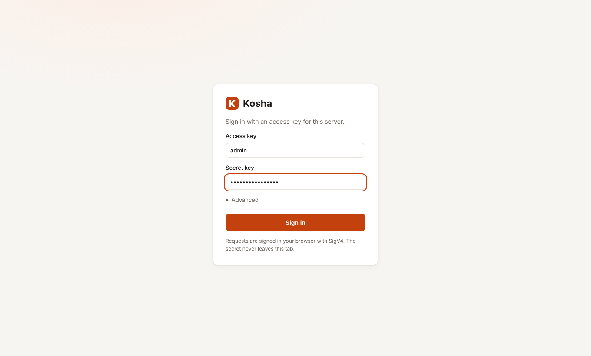
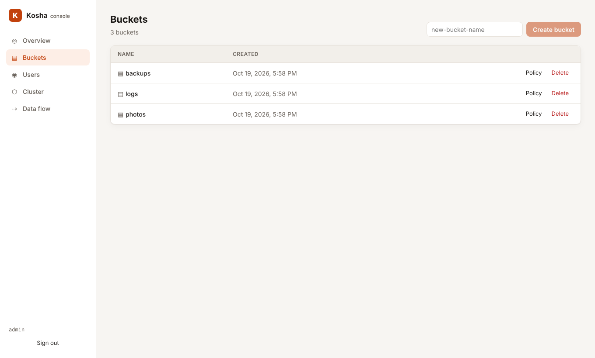
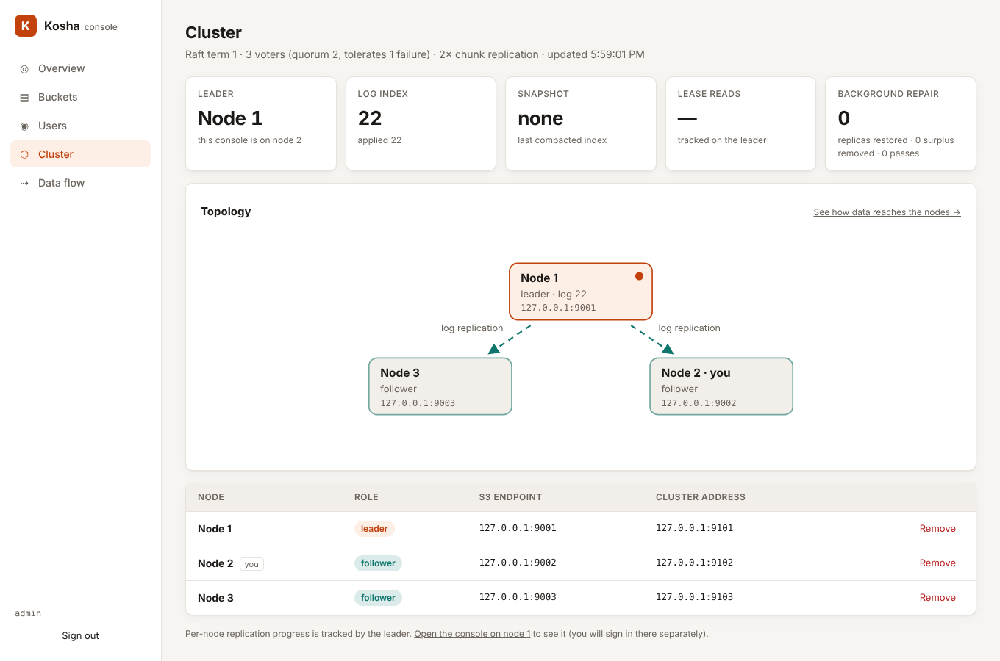
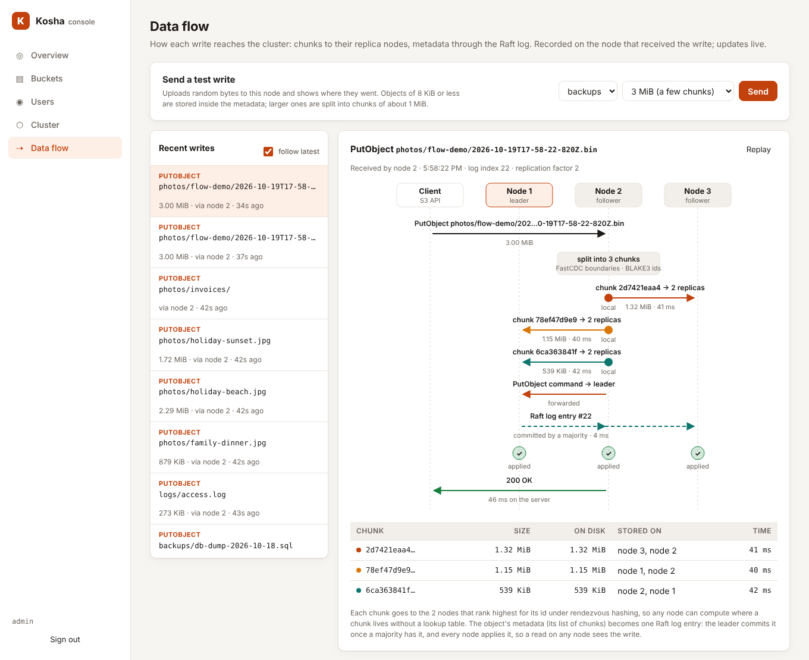

# User guide

Running Kosha, reading and writing data with S3 clients, and using the web console.

## Install

You need **Rust 1.85 or newer**. **Node.js 20 or newer** is optional and only
needed to build the web console. Linux is recommended (io_uring); other
platforms use the thread-pool I/O backend.

```sh
git clone https://github.com/piyooshsinha/Kosha && cd Kosha
(cd ui && npm ci && npm run build)   # optional: builds the console that gets embedded
cargo build --release                # produces ./target/release/kosha
```

## Run a single node

```sh
export KOSHA_ACCESS_KEY=admin
export KOSHA_SECRET_KEY=change-me-please
./target/release/kosha --data-dir ./data --listen 0.0.0.0:9000
```

The log tells you which I/O backend was chosen and where the console is:

```
INFO kosha: storage engine ready io="io_uring"
INFO kosha: Kosha is ready listen=0.0.0.0:9000 console=http://0.0.0.0:9000/_kosha/ui/ mode="single-node"
```

Everything lives in `--data-dir`: `meta.redb` holds the metadata,
`chunks/` the content-addressed data, and `raft/` the Raft log in cluster
mode. Stop the server with Ctrl-C; it shuts down gracefully.

For local experiments you can skip authentication with `--anonymous`. Never
use it on a network you don't control.

### With Docker

```sh
git clone https://github.com/piyooshsinha/Kosha && cd Kosha
printf 'KOSHA_ACCESS_KEY=admin\nKOSHA_SECRET_KEY=%s\n' "$(openssl rand -hex 20)" > .env
docker compose up -d --build
```

This builds the image (console included), stores data in the `kosha-data`
volume, and serves S3 and the console on port 9000 (`KOSHA_PORT` in `.env`
changes it). Any `KOSHA_*` setting from `kosha --help` can be added under
`environment:`. The image runs as an unprivileged user and has a health
check. Upgrade with `git pull && docker compose up -d --build`.

Docker's default seccomp profile blocks io_uring. The compose file therefore
runs the container with `docker/seccomp-io_uring.json`, which is Docker's
default profile ([moby/profiles](https://github.com/moby/profiles)) with
only `io_uring_setup`, `io_uring_enter` and `io_uring_register` added; every
other rule is unchanged. The log shows `io="io_uring"`. With plain
`docker run` and no `--security-opt seccomp=docker/seccomp-io_uring.json`,
Kosha logs `io_uring unavailable` and uses its thread-pool backend instead.

### A 3-node cluster with Docker

```sh
printf 'KOSHA_ACCESS_KEY=admin\nKOSHA_SECRET_KEY=%s\nKOSHA_CLUSTER_SECRET=%s\nKOSHA_HOST=%s\n' \
  "$(openssl rand -hex 20)" "$(openssl rand -hex 24)" "$(hostname -I | awk '{print $1}')" > .env
docker compose -f docker-compose.cluster.yml up -d --build
```

This starts three nodes on one host: S3 and the console on ports 9000, 9001
and 9002 (any node serves every request), with internal traffic on a private
Docker network. Node 1 bootstraps the cluster and nodes 2 and 3 join it; on
later starts they resume from their volumes. `KOSHA_HOST` is the address the
console shows for each node. To use other host ports, set `KOSHA_PORT_1`,
`KOSHA_PORT_2` and `KOSHA_PORT_3` in `.env` (defaults 9000-9002) and run
`up -d` again: each node updates its advertised address when it restarts.
All three share the host's disk and power, so
this tolerates a node process failing, not the machine; for real fault
tolerance, run the nodes on separate machines (see [Run a cluster](CLUSTER.md#run-a-cluster)).
Stopping one container (`docker stop kosha1`) shows a leader change and
the stopped node as unreachable in the console.

To add a fourth node on the same host, start it on the cluster's Docker
network without `KOSHA_INIT` or `KOSHA_JOIN`, then add `kosha4:9100` under
**Add a node** on the console's Cluster page:

```sh
set -a; . ./.env; set +a
docker run -d --name kosha4 --restart unless-stopped --network kosha-cluster_default \
  --security-opt seccomp=./docker/seccomp-io_uring.json -p 9003:9000 -v kosha4:/data \
  -e KOSHA_ACCESS_KEY -e KOSHA_SECRET_KEY -e KOSHA_CLUSTER_SECRET \
  -e KOSHA_NODE_ID=4 -e KOSHA_CLUSTER_LISTEN=0.0.0.0:9100 -e KOSHA_CLUSTER_ADVERTISE=kosha4:9100 \
  -e KOSHA_API_ADVERTISE=${KOSHA_HOST:-127.0.0.1}:9003 kosha:latest
```

### As a service (home server, NUC, VM)

On a Linux machine with systemd (Debian, Ubuntu, Fedora or Arch), one script
builds Kosha from the checkout and installs it as a service:

```sh
git clone https://github.com/piyooshsinha/Kosha && cd Kosha
sudo scripts/install.sh
```

It installs a C toolchain and Rust if they are missing, builds the binary
(and the console if `npm` is available), and installs it as
`/usr/local/bin/kosha`. It creates a `kosha` system user, keeps data in
`/var/lib/kosha`, and generates credentials into `/etc/kosha/kosha.env`
(mode 600). Then it starts `kosha.service` on `0.0.0.0:9000` and prints the
endpoint, console URL and keys. Set `KOSHA_LISTEN` or `KOSHA_DATA_DIR` before
the first run to change those. Later, edit `/etc/kosha/kosha.env` (any
`KOSHA_*` setting from `kosha --help`) and run `sudo systemctl restart kosha`.
Re-running the script rebuilds and upgrades in place without changing the
keys. `sudo scripts/install.sh uninstall` removes the service and binary but
keeps the data.

## Read and write data

Kosha works with S3 clients as-is. Point them at the server with path-style
addressing. Any region name is accepted.

### AWS CLI

```sh
export AWS_ACCESS_KEY_ID=admin AWS_SECRET_ACCESS_KEY=change-me-please AWS_DEFAULT_REGION=us-east-1
alias s3k='aws --endpoint-url http://localhost:9000 s3'

s3k mb s3://photos                                   # create a bucket
s3k cp ./holiday.jpg s3://photos/2026/holiday.jpg    # upload (large files use multipart automatically)
s3k ls s3://photos --recursive                       # list
s3k cp s3://photos/2026/holiday.jpg ./copy.jpg       # download
s3k sync ./website s3://photos/site/                 # sync a directory
s3k cp s3://photos/2026/holiday.jpg s3://photos/backup.jpg   # server-side copy: metadata only
s3k presign s3://photos/2026/holiday.jpg --expires-in 3600   # shareable link
s3k rm s3://photos/2026/holiday.jpg
```

### Versioning, Object Lock and lifecycle

```sh
alias s3api='aws --endpoint-url http://localhost:9000 s3api'

# Keep every version. Versions share chunks, so a new version costs only its changed bytes.
s3api put-bucket-versioning --bucket docs --versioning-configuration Status=Enabled
s3api list-object-versions --bucket docs --prefix report.txt
s3api get-object --bucket docs --key report.txt --version-id 0000000000000001 old.txt

# WORM: a COMPLIANCE-retained version cannot be deleted or shortened by anyone until it expires.
s3api create-bucket --bucket vault --object-lock-enabled-for-bucket
s3api put-object-lock-configuration --bucket vault --object-lock-configuration \
  '{"ObjectLockEnabled":"Enabled","Rule":{"DefaultRetention":{"Mode":"COMPLIANCE","Days":30}}}'
s3api put-object-legal-hold --bucket vault --key ledger.csv --legal-hold Status=ON

# Expire logs after 30 days, old versions after 7, abandoned uploads after 2.
s3api put-bucket-lifecycle-configuration --bucket docs --lifecycle-configuration \
  '{"Rules":[{"ID":"tidy","Status":"Enabled","Filter":{"Prefix":"logs/"},"Expiration":{"Days":30},
    "NoncurrentVersionExpiration":{"NoncurrentDays":7},"AbortIncompleteMultipartUpload":{"DaysAfterInitiation":2}}]}'
```

Lifecycle runs every `--lifecycle-interval-secs` (default one hour). Its
deletions go through the same replicated command path as client deletes, so
Object Lock still protects locked versions.

### Cold tier

Kosha can move cold data to any S3-compatible bucket (AWS S3, MinIO, or
another Kosha) and keep serving it transparently:

```sh
kosha --cold-tier-endpoint https://s3.eu-west-1.amazonaws.com --cold-tier-bucket my-archive \
      --cold-tier-region eu-west-1 --cold-tier-access-key AKIA… --cold-tier-secret-key … ...

# move objects after 30 days (and old versions after 7 with NoncurrentVersionTransitions)...
s3api put-bucket-lifecycle-configuration --bucket logs --lifecycle-configuration '{"Rules": [
  {"ID": "archive", "Status": "Enabled", "Filter": {"Prefix": "2025/"},
   "Transitions": [{"Days": 30, "StorageClass": "GLACIER_IR"}]}]}'
# ...or write straight to the cold tier
aws --endpoint-url http://localhost:9000 s3 cp backup.tar s3://logs/backup.tar --storage-class GLACIER_IR
```

- **Classes:** `STANDARD_IA`, `ONEZONE_IA`, `INTELLIGENT_TIERING`,
  `GLACIER_IR`, `GLACIER` and `DEEP_ARCHIVE` all mean "cold tier". GETs read
  through directly; there is no restore step. The class is reported by
  HEAD/GET and in listings.
- **Chunks, not objects, move.** A chunk leaves local disks only when every
  object using it is cold. Data shared with a STANDARD object stays local, and
  identical cold data is uploaded once.
- **What gets uploaded** is the chunk's stored bytes: compressed, and
  encrypted when encryption at rest is on. The cold provider never sees
  plaintext.
- **Reads** are verified against the content address, like every other read.
- **Deletes:** deleting the last object that uses a chunk deletes its remote
  copy.
- **Clusters:** the leader uploads, every node drops its local copies, and
  background repair leaves offloaded chunks alone.
- **Startup check:** Kosha writes and deletes a probe object, so a
  misconfigured tier fails immediately.
- `/_kosha/stats` and the console's Overview show the bytes in the cold tier.

**Access-based tiering.** Instead of fixed ages, let reads decide, through
S3's Intelligent-Tiering configuration API:

```sh
s3api put-bucket-intelligent-tiering-configuration --bucket media --id auto \
  --intelligent-tiering-configuration '{"Id": "auto", "Status": "Enabled",
    "Filter": {"Prefix": "videos/"},
    "Tierings": [{"Days": 90, "AccessTier": "ARCHIVE_ACCESS"}]}'
```

- **Demotion:** objects under the filter that nobody has read or written for
  `Days` move to the cold tier. They show as `INTELLIGENT_TIERING`.
- **Promotion:** the first GET of such an object serves it from the cold tier
  and, in the background, copies its chunks back to local disk and returns
  it to STANDARD.
- **Demoting again is free:** the remote copy is kept, so a promoted object
  that goes cold a second time is evicted again without another upload.
- **How reads are recorded:** each node collects reads in memory and records
  them as one replicated command every 30 seconds, so reads never wait on
  Raft. A crash can lose the last 30 seconds of read history, which only
  delays a demotion.
- Unlike AWS, `Days` may be any value from 1 upwards.
- Objects moved by lifecycle rules or uploaded with a cold class stay where
  they were put; only auto-tiered objects are promoted.

### Event notifications

Kosha posts S3-format event messages to webhooks when objects change. Name
the targets on the servers, then point buckets at them with the usual S3 API:

```sh
kosha --notify-webhook audit=https://hooks.example.com/kosha?token=… ...

s3api put-bucket-notification-configuration --bucket media --notification-configuration '{
  "QueueConfigurations": [{"Id": "uploads", "QueueArn": "arn:kosha:sqs::audit:webhook",
    "Events": ["s3:ObjectCreated:*", "s3:ObjectRemoved:*"],
    "Filter": {"Key": {"FilterRules": [{"Name": "prefix", "Value": "images/"}]}}}]}'
```

Each event is one `POST` with the standard
[S3 event message structure](https://docs.aws.amazon.com/AmazonS3/latest/userguide/notification-content-structure.html)
(`Records[0].eventName` is e.g. `ObjectCreated:Put`).

- **Event types:** `ObjectCreated:{Put,Copy,CompleteMultipartUpload}`,
  `ObjectRemoved:{Delete,DeleteMarkerCreated}`,
  `LifecycleExpiration:{Delete,DeleteMarkerCreated}`,
  `ObjectTagging:{Put,Delete}`, and their `*` forms.
- **Durability:** events are written to a replicated queue in the same
  transaction as the change. A crash, a restart or a new leader never loses
  one.
- **Order:** they are delivered in commit order, per target.
- **At least once:** a failing webhook is retried with backoff, and its
  queue holds up to 100,000 events. A leader crash between a delivery and its
  acknowledgement can repeat an event; deduplicate on
  `s3.object.sequencer`.
- **Verified:** in a 3-node test, the leader was SIGKILLed during 300
  uploads, and all 300 events arrived in order.


```python
import boto3

s3 = boto3.client(
    "s3",
    endpoint_url="http://localhost:9000",
    aws_access_key_id="admin",
    aws_secret_access_key="change-me-please",
    region_name="us-east-1",
)
s3.put_object(Bucket="photos", Key="hello.txt", Body=b"hi", ContentType="text/plain",
              Metadata={"owner": "me"})
print(s3.get_object(Bucket="photos", Key="hello.txt")["Body"].read())
s3.upload_file("big.iso", "photos", "isos/big.iso")          # multipart for large files
url = s3.generate_presigned_url("get_object", Params={"Bucket": "photos", "Key": "hello.txt"})

# Conditional create: succeeds only if the key does not exist yet (a simple lock).
s3.put_object(Bucket="photos", Key="locks/job-42", Body=b"", IfNoneMatch="*")
```

### Rust (aws-sdk-s3)

```rust
let conf = aws_sdk_s3::Config::builder()
    .behavior_version(aws_sdk_s3::config::BehaviorVersion::latest())
    .region(aws_sdk_s3::config::Region::new("us-east-1"))
    .endpoint_url("http://localhost:9000")
    .credentials_provider(aws_sdk_s3::config::Credentials::new("admin", "change-me-please", None, None, "kosha"))
    .force_path_style(true)
    .build();
let s3 = aws_sdk_s3::Client::from_conf(conf);
s3.put_object().bucket("photos").key("a.txt")
    .body(aws_sdk_s3::primitives::ByteStream::from_static(b"hello")).send().await?;
```

### curl

curl can sign requests itself:

```sh
curl --aws-sigv4 "aws:amz:us-east-1:s3" --user admin:change-me-please \
     -T ./report.pdf http://localhost:9000/photos/report.pdf
curl --aws-sigv4 "aws:amz:us-east-1:s3" --user admin:change-me-please \
     http://localhost:9000/photos/report.pdf -o report.pdf
```

## How to use Kosha

Kosha has two front doors on the same port:

- **the web console** at `http://<server>:9000/_kosha/ui/`, for people: buckets,
  files, users and the cluster, in a browser;
- **the S3 API** at `http://<server>:9000`, for programs: backup tools, apps,
  scripts and SDKs (see [Read and write data](#read-and-write-data)).

Both use the same buckets, files and keys. A typical first session:

### Step 1: Sign in

Open `http://<server>:9000/_kosha/ui/` and sign in with the access key and
secret the server was started with (`KOSHA_ACCESS_KEY` and
`KOSHA_SECRET_KEY`). These are the **root keys**: they can do everything,
so keep them for administration. The console signs every request in your
browser (SigV4), so the secret never leaves the tab and there are no server
sessions. **Advanced** sets the region, which Kosha accepts whatever its
value. The console works over plain HTTP and on phones.



### Step 2: Check the overview

The **Overview** page shows how many objects you store, how much data
clients uploaded (logical size) and how much it takes on disk. The bars show
where the savings come from: identical chunks stored once (dedup) and
compression where it helps. The subtitle names the node you're on, its role
in a cluster and the disk I/O backend.


### Step 3: Create a bucket

A bucket is a top-level folder with its own name and access rules. On
**Buckets**, type a name (3–63 characters: lowercase letters, digits, `-`
and `.`) and click **Create bucket**. Each bucket has:

- **Policy**: who may access it without keys. The editor starts from a
  public-read template, for serving a static website or shared downloads;
  save it only if that is what you want. Invalid JSON can't be saved, and
  the server rejects rules that don't fit the bucket.
- **Delete**: only works on an empty bucket.



### Step 4: Upload, browse and share files

Click a bucket to browse it.

- **Upload**: click **Upload** or drag files onto the list. Each file shows
  its progress. For very large files or whole folders, the AWS CLI (below)
  is faster: it uploads in parallel parts and can resume.
- **Folders**: **New folder** creates one; click a folder to open it and the
  path at the top to go back. Folders are just key prefixes (`2026/holiday.jpg`).
- **Details**: click a file to see its size, type, date and ETag.
  **Download** saves it and **Open** shows it in a new tab.
- **Share**: pick how long a link stays valid (1 hour, 1 day or 7 days) and
  click **Copy link**. Anyone with the link can download that one file until
  it expires, without an account.
- **Delete**: tick files (or the header box for all) and click **Delete**.


Uploading the same content twice costs nothing extra: in this example a copy
of `holiday-beach.jpg` in another bucket is stored once, which is part of the
saving on the Overview page.

### Step 5: Give each app its own keys

Don't put the root keys in apps. On **Users**, create a user per app or
person, with a starting policy:

| Starting policy | What the user can do |
|---|---|
| Read-only | list and download from every bucket |
| Home directory | read and write only under `home/<user name>/` in bucket `home` |
| No policy | nothing until you attach one with **Policy** |

The new keys are shown **once**: copy them into the app straight away. Later
you can edit the user's **Policy** (standard AWS IAM JSON), **Disable** it
temporarily, **Rotate** its secret if it leaks, or **Delete** it.


Then point the app at Kosha with those keys. Most S3 tools need four
settings:

```sh
export AWS_ACCESS_KEY_ID=<access key>  AWS_SECRET_ACCESS_KEY=<secret key>
export AWS_DEFAULT_REGION=us-east-1     # any value works
aws --endpoint-url http://<server>:9000 s3 sync ~/Pictures s3://photos/   # e.g. back up a folder
```

In SDKs and apps the same settings are the endpoint URL, the two keys, a
region, and **path-style addressing** (`force_path_style`, "use path-style
URLs"). Examples for the AWS CLI, Rust, Python, curl and more are in
[Read and write data](#read-and-write-data).

### Step 6: Watch the cluster (cluster mode)

**Cluster** shows the members live, refreshed every 2 seconds:

- which node leads and how far each follower is behind its log;
- unreachable nodes, marked as such;
- the Raft term, log and snapshot indexes, lease-read hit rate and
  background-repair counters.

**Add a node** admits a new Kosha node: start it with the cluster secret,
its own node id and no `--init`/`--join`, then enter the address of its
cluster port (e.g. `10.0.0.4:9100`). **Remove** takes a node out; its data
is re-replicated to the others, and while its process still runs it can be
added back the same way.



**Data flow** shows how each recent write reached the cluster, as a
sequence diagram:

1. the client's request to the node that received it;
2. the object split into chunks, and the nodes each chunk was stored on
   (or its erasure-coded shards);
3. the metadata command forwarded to the leader;
4. the Raft log entry and its commit time;
5. which nodes have applied it.

Pick a bucket and size and click **Send** to watch a test write. Every node
keeps its last 200 writes in memory, and the page merges them from all
members, so the list starts empty after a restart.



The console follows your system's light or dark theme:


### Everyday tasks

| I want to… | Do this |
|---|---|
| back up a folder from my laptop | `aws --endpoint-url http://<server>:9000 s3 sync ~/Documents s3://backups/laptop/` (rerun it to copy only changes) |
| share one file with someone | open the file in the console, pick a duration, **Copy link** |
| host a static website | upload it to a bucket, then **Policy** → save the public-read template |
| give an app limited access | **Users** → create a user with a starting policy, put its keys in the app |
| see how much space dedup saves | **Overview** |
| keep old versions or block deletes | turn on [versioning or Object Lock](#versioning-object-lock-and-lifecycle) |
| delete old files automatically | add a [lifecycle rule](#versioning-object-lock-and-lifecycle) |
| move rarely read data to cheaper storage | set up the [cold tier](#cold-tier) |
| find out whether the cluster is healthy | **Cluster**: one leader, every node reachable and in sync |
| add capacity | start a new node, then **Cluster** → **Add a node** ([Run a cluster](CLUSTER.md#run-a-cluster)) |
| replace a failed node | **Cluster** → **Remove** it, start a new node, then **Add a node** |
| know which node served a request | every response has an `x-kosha-node` header; the Data flow page shows it per write |
| check the server from a script | `curl http://<server>:9000/_kosha/health`, metrics in [Monitoring](CLUSTER.md#monitoring) |
